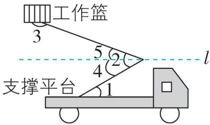

> [!success]- 必刷题
>
> > [!success] **【答案】** $160^{\circ}$
>
> > [!note]- **【解析】**
> > 如图所示, 过 $\angle 2$ 顶点作直线 $l / /$ 支撑平台, 直线 $l$ 将 $\angle 2$ 分成 $\angle 4$ 和 $\angle 5$ .
> >
> > 
> >
> > ∵ 工作篮底部与支撑平台平行, 直线 l//支撑平台, ∴ 直线 l//支撑平台 // 工作篮底部, ∴ $\angle1 = \angle4 = 30^{\circ}, \angle5 + \angle3 = 180^{\circ}$ . ∵ $\angle4 + \angle5 = \angle2 = 50^{\circ}, \therefore \angle5 = 50^{\circ} - \angle4 = 20^{\circ}, \therefore \angle3 = 180^{\circ} - \angle5 = 160^{\circ}$ , 故答案为 $160^{\circ}$ .
