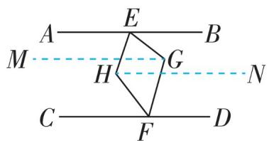

> [!success]- 必刷题
>
> > [!success] **【答案】** 124
>
> > [!note]- **【解析】**
> > 如图, 过点 $G$ 作 $GM \parallel AB$ . $\because AB \parallel CD$ , $\therefore CD \parallel MG \parallel AB$ , $\therefore \angle AEG + \angle EGM = 180^\circ$ , $\angle CFG + \angle FGM = 180^\circ$ . $\because \angle EGF = \angle MGF + \angle MGE = 112^\circ$ , $\therefore \angle AEG + \angle CFG = 360^\circ - 112^\circ = 248^\circ$ . $\because EH, FH$ 分别是 $\angle AEG$ 和 $\angle CFG$ 的平分线, $\therefore \angle HEA + \angle HFC = \frac{1}{2} (\angle AEG + \angle CFG) = 124^\circ$ . 过点 $H$ 作 $HN \parallel AB$ . $\because AB \parallel CD$ , $\therefore HN \parallel AB \parallel CD$ , $\therefore \angle HEA = \angle EHN$ , $\angle HFC = \angle FHN$ , $\therefore \angle EHF = \angle EHN + \angle FHN = \angle HEA + \angle HFC = 124^\circ$ . 故答案为 124.
> >
> > 
