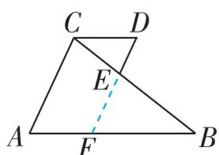
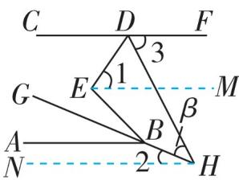
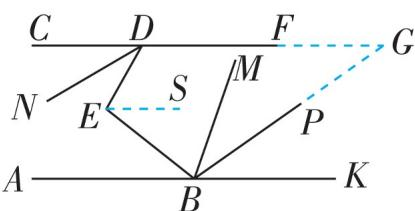

> [!success]- 必刷题
>
> > [!success] **【答案】** (1)
>
> > [!note]- **【解析】**
> > 【证明】如图(1), 延长 $DE$ 交 $AB$ 于点 $F$ . $\because \angle ACB + \angle BED = 180^{\circ}, \angle CED + \angle BED = 180^{\circ}, \therefore \angle ACB = \angle CED, \therefore AC \parallel DF, \therefore \angle A = \angle DFB.\because \angle A = \angle D, \therefore \angle DFB = \angle D, \therefore AB \parallel$
> >
> > (1)如图(1)，延长 DE 交 AB 于点 F，根据 $\angle ACB + \angle BED = 180^{\circ}$ ， $\angle CED + \angle BED = 180^{\circ}$ ，可得 $\angle ACB = \angle CED$ ，所以 $AC \parallel DF$ ，可得 $\angle A = \angle DFB$ 。由 $\angle A = \angle D$ ，进而可得结论。
> >
> > (2)如图(2)，作 $EM \parallel CD$ ， $HN \parallel CD$ ，根据 $AB \parallel CD$ ，可得 $AB \parallel EM \parallel HN \parallel CD$ ，根据平行线的性质得角之间的关系，再根据 $\angle DEB$ 比 $\angle DHB$ 大 $60^{\circ}$ 列出等式，即可求 $\angle DEB$ 的度数。(3)如图(3)，过点 $E$ 作 $ES \parallel CD$ ，设直线 $CD$ 和射线 $BP$ 相交于点 $G$ ，根据平
> >
> > 行线的性质和角平分线定义可求 $\angle PBM$ 的度数.
> >
> > CD.
> >
> > 
> > 图(1)
> >
> > 
> > 图(2)
> >
> > 【解】(2)如图(2),作 $EM \parallel CD, HN \parallel CD.$ $\because AB \parallel CD, \therefore AB \parallel EM \parallel HN \parallel CD, \therefore \angle 1 + \angle EDF = 180^\circ, \angle MEB = \angle ABE. \because BG$ 平分 $\angle ABE, \therefore \angle ABG = \frac{1}{2} \angle ABE. \because AB \parallel HN,$ $\therefore \angle 2 = \angle ABG. \because CF \parallel HN, \therefore \angle 2 + \angle \beta = \angle 3,$ $\therefore \frac{1}{2} \angle ABE + \angle \beta = \angle 3. \because DH$ 平分 $\angle EDF,$ $\therefore \angle 3 = \frac{1}{2} \angle EDF, \therefore \frac{1}{2} \angle ABE + \angle \beta = \frac{1}{2} \angle EDF,$ $\therefore \angle \beta = \frac{1}{2} (\angle EDF - \angle ABE), \therefore \angle EDF - \angle ABE = 2\angle \beta.$ 设 $\angle DEB = \angle \alpha, \therefore \angle \alpha = \angle 1 + \angle MEB = 180^\circ - \angle EDF + \angle ABE = 180^\circ - (\angle EDF - \angle ABE) = 180^\circ - 2\angle \beta. \because \angle DEB$ 比 $\angle DHB$ 大 $60^\circ, \therefore \angle \alpha - 60^\circ = \angle \beta, \therefore \angle \alpha = 180^\circ - 2(\angle \alpha - 60^\circ),$ 解得 $\angle \alpha = 100^\circ, \therefore \angle DEB$ 的度数为 $100^\circ.$
> >
> > (3)如图(3),过点 $E$ 作 $ES \parallel CD$ ,设直线 $CD$ 和射线 $BP$ 相交于点 $G$ . $\because BM$ 平分
> >
> > 
> > 图(3)
> >
> > $\angle EBK, DN$ 平分 $\angle CDE, \therefore \angle EBM = \angle MBK = \frac{1}{2} \angle EBK, \angle CDN = \angle EDN = \frac{1}{2} \angle CDE. \because ES // CD, AB // CD, \therefore ES // AB // CD, \therefore \angle DES = \angle CDE, \angle BES = 180^\circ - \angle EBK, \angle G = \angle PBK.$ 由(2)可知 $\angle DEB = 100^\circ, \therefore \angle CDE + 180^\circ - \angle EBK = 100^\circ, \therefore \angle EBK - \angle CDE = 80^\circ. \because BP // DN, \therefore \angle CDN = \angle G, \therefore \angle PBK = \angle G = \angle CDN = \frac{1}{2} \angle CDE, \therefore \angle PBM = \angle MBK - \angle PBK = \frac{1}{2} \angle EBK - \frac{1}{2} \angle CDE = \frac{1}{2} (\angle EBK - \angle CDE) = \frac{1}{2} \times 80^\circ = 40^\circ.$
> >
> > ## 全章综合训练
