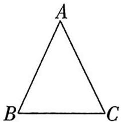

<!-- question-source:start -->
5[2025 重庆铜梁区校级期中]学习了等腰三角形后,爱探究的小巴同学发现:等腰三角形顶角平分线上任意一点到底边两端点的距离相等.于是他想出了如下证明方法,请根据他的思路完成以下作图与填空.

如图, 在 $\triangle ABC$ 中, $AB = AC$ .

(1)用直尺(无刻度)和圆规,作 $\angle BAC$ 的平分线 $AD$ 交 $BC$ 于点 $D$ ,在线段 $AD$ 上任取一点 $E$ (不与点 $A,D$ 重合),连接 $EB,EC$ .(不写作法,保留作图痕迹)

(2)在(1)的条件下,求证:EB=EC.
证明:∵AB=AC,AD是∠BAC的平分线,∴AD是边BC上的高,AD是边BC上的\_\_\_\_(等腰三角形\_\_\_\_),∴AD垂直平分BC.∵AD垂直平分BC,点E为AD上一点,∴EB=\_\_\_\_.
小巴进一步研究发现,等腰三角形顶角平分线所在直线上的点均有此特征.请你依照题意完成下面命题:等腰三角形顶角平分线所在直线上任意一点\_\_\_\_.

<!-- question-source:end -->

![[Q00106260A1]]
