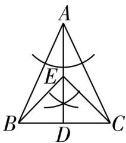

> [!success]- 必刷题
>
> > [!success] **【答案】** 中线，三线合一， $EC$ ，到底边两端点的距离相等
>
> > [!note]- **【解析】**
> > 【解】(1)如图所示即为所求.
> >
> > 
> >
> > 思路分析
> > 在题图中发现 $l_{1}, l_{2}$ 被直线 $l_{3}$ 所截, 且已知 $\angle1=62^{\circ}$ , 可根据同位角相等, 两直线平行来补充条件.
> >
> > (2) $\because AB = AC, AD$ 是 $\angle BAC$ 的平分线， $\therefore AD$ 是边 $BC$ 上的高， $AD$ 是边 $BC$ 上的中线（等腰三角形三线合一）， $\therefore AD$ 垂直平分 $BC$ . $\because AD$ 垂直平分 $BC$ ，点 $E$ 为 $AD$ 上一点， $\therefore EB = EC$ . 命题：等腰三角形顶角平分线所在直线上任意一点到底边两端点的距离相等. 故答案为中线，三线合一， $EC$ ，到底边两端点的距离相等.
> >
> > 先确定两角之间的位置关系,再根据平行线的判定来确定是否平行,以及具体是哪两条直线平行.
