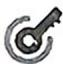

## 课时 3 定理与证明

## 刷基础

## 知识点1 公理、定理、证明的概念

![[初中/课堂同步/教辅/必刷题/2026 八上必刷题 北师大数学/07_第七章_命题与证明/课时_3_定理与证明/questions/Q00106414.md]]
![[初中/课堂同步/教辅/必刷题/2026 八上必刷题 北师大数学/07_第七章_命题与证明/课时_3_定理与证明/questions/Q00106258.md]]
![[初中/课堂同步/教辅/必刷题/2026 八上必刷题 北师大数学/07_第七章_命题与证明/课时_3_定理与证明/questions/Q00106259.md]]

## 知识点2 推理证明

![[初中/课堂同步/教辅/必刷题/2026 八上必刷题 北师大数学/07_第七章_命题与证明/课时_3_定理与证明/questions/Q00106415.md]]
![[初中/课堂同步/教辅/必刷题/2026 八上必刷题 北师大数学/07_第七章_命题与证明/课时_3_定理与证明/questions/Q00106260.md]]
![[初中/课堂同步/教辅/必刷题/2026 八上必刷题 北师大数学/07_第七章_命题与证明/课时_3_定理与证明/questions/Q00106261.md]]
