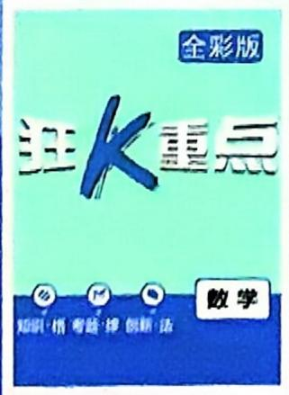
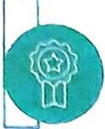
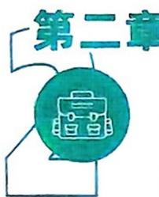
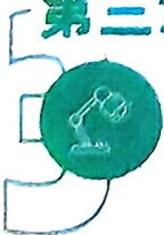
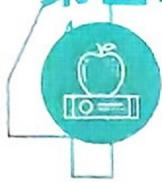
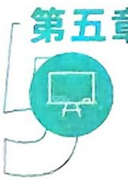
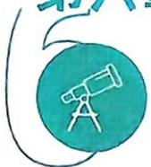
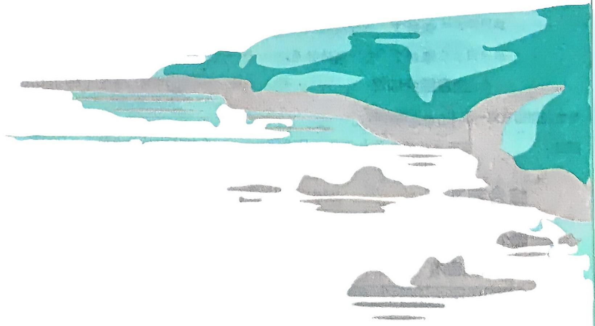
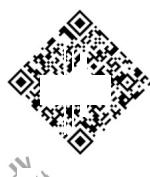

<!-- source-part:1 pages:1-50 -->

# 初中 CHUZHONG BISHUATI 2026 必刷题® 公众号·满满分享库

有全系的几何图形没有全系的人生

新NEW 考向·素材·考法

开明出版社

新教材适用

数学

八年级上册 BS

# 初中 2026 必刷题

主 编：杨文彬

公众号\*满满分享库

编者：王岳阳 刘雷 孟超 王道魁 神英英

肖玉芝 许生友 邓方清 沈子涵

审订：杨彩银 郭炜伟 陈露

开明出版社数学
八年级上册 BS

## 目录

## 勾股定理

(正文)(答案)
1 探索勾股定理 …… (1) (D1)
课时 1 认识勾股定理 …… 刷基础 提升 (1) (D1)
课时 2 验证并应用勾股定理 …… 刷基础 (3) (D2)
2 一定是直角三角形吗 …… 刷基础 提升 (4) (D4)
公众号\*满满分享库
3 勾股定理的应用 …… 刷基础 提升 (6) (D6)
重难专题 1 利用勾股定理解决折叠问题 …… 刷难关 (8) (D7)
☆问题解决策略：反思 …… 刷提升 (9) (D8)
全章综合训练 …… 刷中考 章测 (10) (D8)

## 重难题型微课

## 第二章

## 实数

1 认识实数 …… 刷基础 (12) (D10)
2 平方根与立方根 …… (13) (D11)
课时 1 算术平方根 …… 刷基础 提升 (13) (D11)
课时 2 平方根 …… 刷基础 (15) (D12)
课时 3 立方根 …… 刷基础 提升 (16) (D13)
课时 4 估算与用计算器开方 …… 刷基础 (18) (D14)
3 二次根式 …… (19) (D15)
课时 1 二次根式的乘除法 …… 刷基础 (19) (D15)
课时 2 二次根式的化简及加减运算 …… 刷基础 提升 (20) (D16)
课时 3 二次根式的混合运算 …… 刷基础 提升 (22) (D17)
大招专题 1 二次根式比较大小的方法 …… 刷难关 (24) (D19)
大招专题 2 二次根式的化简求值 …… 刷难关 (25) (D20)
全章综合训练 …… 刷中考 章测 (26) (D21)
重难题型微课
与非负性有关的分类讨论 P14T5 与立方根有关的数字问题 P17T5
利用非负性求参数的值 P27T5 比较实数大小 P27T8

## 第三章

## 位置与坐标

1 确定位置 …… 刷基础（29）(D23)
2 平面直角坐标系 …… (30)(D23)
课时1 平面直角坐标系 …… 刷基础（30)(D23)
课时2 平面直角坐标系中点的坐标特征 …… 刷基础（提升（31）(D24)
课时3 建立适当的平面直角坐标系求点的坐标 …… 刷基础（提升（33）(D25)
3 轴对称与坐标变化 …… 刷基础（提升（35）(D27)

## 新考法 新素材

研究对比全国近十年中考真题卷,发现各省市的中考会不断借鉴或探究新考法,同时会挖掘时事热点等新素材,创造新情境灵活考查知识点。中考是我们平时学习的风向标,因此我们需要关注新考法、新素材。

## 新考法

\- 过直线上一点作已知直线的垂线的两种方法
- 新定义“完美组合数”考查算术平方根
- 用钟代码的方式确定位置
- 建立不同的坐标系求点的坐标
- 结合直角三角尺确定一次函数的表达式
- 与钟表有关的一次函数的应用
- P5/T2
- P13/T5
- P29/T4
- P34/T5
- P49/T3
- P59/T1

## 新素材

\- 以“电影《哪吒之魔童闹海》”为背景考查点的坐标
- P39/T1
- 以“DeepSeek”为背景考查列二元一次方程组
- P60/T10
- 以“第九届亚洲冬季运动会”为背景考查箱线图
- P87/T3

## 新考向

## 推荐理由

教育部发布的《关于加强初中学业水平考试命题工作的意见》中指出：弘扬中华优秀传统文化，提高探究性、开放性试题比例，积极探索跨学科命题，提高试题情境设计水平。结合《义务教育数学课程标准(2022年版)》新变化，通过分析全国百余套中考试题，发现以传统文化为背景的试题，以及探究性、开放性、综合性、跨学科试题在中考中出现得越来越频繁，故精选部分试题，让学生感受考向变化。

## 目录

大招专题3 利用点的坐标规律探究问题 …… 刷难关（37）（D28）
全章综合训练 …… 刷中考 章测（38）（D30）
重难题型微课
根据面积求点的坐标 P34T6

## 第四章 一次函数

1 函数 …… 刷基础 (40) (D31)
2 认识一次函数 …… (41) (D32)
课时1 “均匀”变化 …… 刷基础 (41) (D32)
课时2 一次函数与正比例函数…… 刷基础 (42) (D32)
课时3 利用一次函数解决分段计费问题 …… 刷提升 (43) (D33)
3 一次函数的图象 …… (44) (D33)
课时1 正比例函数的图象和性质…… 刷基础 提升 (44) (D33)
课时2 一次函数的图象和性质…… 刷基础 提升 (46) (D35)
4 一次函数的应用 …… (48) (D37)
课时1 确定一次函数的表达式…… 刷基础 提升 (48) (D37)
课时2 单个一次函数图象的实际应用 …… 刷基础 提升 (50) (D39)
课时3 两个一次函数图象的实际应用 …… 刷基础 提升 (52) (D40)
重难专题2 一次函数中的几何变换 …… 刷难关 (54) (D42)
重难专题3 一次函数的综合 …… 刷难关 (55) (D43)
全章综合训练 …… 刷中考 章测 (57) (D46)

“将军饮马”问题 P45T8 一次函数与几何图形的综合 P47T4
一次函数与最值问题 P57T3 一次函数与规律探究问题 P58T9

## 第五章 二元一次方程组

1 认识二元一次方程组 …… 刷基础 (60) (D48)
2 二元一次方程组的解法 …… (61) (D49)
课时1 代入消元法 …… 刷基础 提升 (61) (D49)
课时2 加减消元法 …… 刷基础 提升 (63) (D51)
重难专题4 二元一次方程组的含参问题 …… 刷难关 (66) (D53)
3 二元一次方程组的应用 …… (67) (D54)
课时1 古算术问题 …… 刷提升 (67) (D54)
课时2 增收节支 …… 刷提升 (68) (D55)
课时3 行程问题 …… 刷提升 (69) (D55)
4 二元一次方程与一次函数 …… (70) (D56)
课时1 二元一次方程(组)与一次函数 …… 刷基础 提升 (70) (D56)
课时2 用二元一次方程组确定一次函数表达式 …… 刷基础 提升 (72) (D57)
\*5 三元一次方程组 …… 刷基础 (74) (D59)
☆问题解决策略：逐步确定 …… 刷提升 (75) (D60)

## 专题索引

## 微专题

微专题1 一次函数与图形面积问题
P49
微专题2 巧解二元一次方程组 P65
微专题3 平均数、方差的变化规律
P83

## 重难专题

重难专题 1 利用勾股定理解决折叠
问题
P8
类型 1 与三角形有关的折叠
类型 2 与四边形有关的折叠
重难专题 2 一次函数中的几何变换
P54
类型 1 一次函数中的平移问题
类型 2 一次函数中的旋转问题
类型 3 一次函数中的翻折问题
重难专题 3 一次函数的综合
P55
类型 1 一次函数的图象经过某定点问题
类型 2 一次函数中的“将军饮马”问题
类型 3 面积分割问题
类型 4 取值范围问题
类型 5 存在性问题
重难专题 4 二元一次方程组的含参
问题
P66
类型 1 根据解的关系求参数
类型 2 同解问题求参数
类型 3 错解问题求参数
类型 4 整数解问题求参数

## 目录

全章综合训练 …… 刷中考 章测（76）(D60)

## 重难题型微课

二元一次方程组的错解问题 P62T7 二元一次方程组的同解问题 P64T5
一次函数与二元一次方程组综合 P71T5 一次函数与轴对称综合 P73T2

## 第六章 数据的分析

1 平均数与方差 …… (79) (D63)
课时 1 众数与平均数 …… 刷基础 提升 (79) (D63)
课时 2 加权平均数 …… 刷基础 (81) (D64)
课时 3 方差与标准差 …… 刷基础 提升 (82) (D65)
课时 4 分析数据的离散程度 …… 刷基础 (84) (D66)
2 中位数与箱线图 …… (85) (D67)
课时 1 中位数 …… 刷基础 提升 (85) (D67)
课时 2 箱线图 …… 刷基础 (87) (D68)
3 哪个团队收益大 …… 刷基础 (88) (D69)
全章综合训练 …… 刷中考 章测 (89) (D69)

## 重难题型微课

数据变化对平均数的影响 P80T2 数据缺失问题 P83T4
中位数不变分析数据 P86T3

## 第七章 命题与证明

1 认识证明 …… (92) (D71)
课时 1 为什么要证明 …… 刷基础 (92) (D71)
课时 2 定义与命题 …… 刷基础 (93) (D72)
课时 3 定理与证明 …… 刷基础 (94) (D73)

2 平行线的证明 …… (95) (D73)
课时 1 平行线的判定 …… 刷基础 提升 (95) (D73)
课时 2 平行线的性质 …… 刷基础 提升 (97) (D74)

全章综合训练 …… 刷中考 章测 (99) (D76)

重难题型微课
三角板的叠放与旋转 P96T6 平行线中的动点问题 P98T5

## 综合与实践

哪个城市夏天更热 …… 刷实践（102）(D79)
神奇的加密术 …… 刷实践（103）(D79)

## 中考新考向备训

■新考向1 传统文化 ■新考向2 跨学科综合
■新考向3 开放性试题 ■新考向4 22版课标新增知识点
■新考向5 项目化学习

## 专题索引

## 大招专题

方法
P24
母题学大招 1 平方法
母题学大招 2 作差/作商法
母题学大招 3 取近似值后比较
母题学大招 4 取中间值比较
母题学大招 5 分子/分母有理化
母题学大招 6 取倒数法
大招专题 2 二次根式的化简求值

母题学大招 7 运用二次根式的非负性求值
母题学大招 8 运用数形结合化简
母题学大招 9 巧用乘法公式化简求值
母题学大招 10 巧用分母有理化化简求值
母题学大招 11 巧用整体代换化简求值
大招专题 3 利用点的坐标规律探究问题
P37
母题学大招 12 循环规律
母题学大招 13 横、纵坐标的变化规律

## 光 light up your life 李研慧

夜深
寒风阵阵 海浪翻滚
隐藏着的灵魂
怎肯默默无闻
曾与礁石相撞
不屈遍体鳞伤
也曾掀起巨浪

回首与月相望
月光洒在海上
怅惘黑夜漫长
月落参横
破晓梦想迎来曙光
我不应是月亮
我本就会发光

![[初中/课堂同步/教辅/必刷题/2026 八上必刷题 北师大数学/01_第一章_勾股定理/课时_1_认识勾股定理/刷基础.md]]
![[初中/课堂同步/教辅/必刷题/2026 八上必刷题 北师大数学/01_第一章_勾股定理/课时_1_认识勾股定理/刷提升.md]]
![[初中/课堂同步/教辅/必刷题/2026 八上必刷题 北师大数学/01_第一章_勾股定理/课时_2_验证并应用勾股定理/课时_2_验证并应用勾股定理.md]]
![[初中/课堂同步/教辅/必刷题/2026 八上必刷题 北师大数学/01_第一章_勾股定理/2_一定是直角三角形吗/刷基础.md]]
![[初中/课堂同步/教辅/必刷题/2026 八上必刷题 北师大数学/01_第一章_勾股定理/2_一定是直角三角形吗/刷提升.md]]
![[初中/课堂同步/教辅/必刷题/2026 八上必刷题 北师大数学/01_第一章_勾股定理/3_勾股定理的应用/刷基础.md]]
![[初中/课堂同步/教辅/必刷题/2026 八上必刷题 北师大数学/01_第一章_勾股定理/3_勾股定理的应用/刷提升.md]]
![[初中/课堂同步/教辅/必刷题/2026 八上必刷题 北师大数学/01_第一章_勾股定理/重难专题_1_利用勾股定理解决折叠问题/重难专题_1_利用勾股定理解决折叠问题.md]]
![[初中/课堂同步/教辅/必刷题/2026 八上必刷题 北师大数学/01_第一章_勾股定理/_问题解决策略_反思/_问题解决策略_反思.md]]
![[初中/课堂同步/教辅/必刷题/2026 八上必刷题 北师大数学/01_第一章_勾股定理/全章综合训练/刷中考.md]]
![[初中/课堂同步/教辅/必刷题/2026 八上必刷题 北师大数学/01_第一章_勾股定理/全章综合训练/刷章测.md]]
![[初中/课堂同步/教辅/必刷题/2026 八上必刷题 北师大数学/02_第二章/1_认识实数/1_认识实数.md]]
![[初中/课堂同步/教辅/必刷题/2026 八上必刷题 北师大数学/02_第二章/课时_1_算术平方根/刷基础.md]]
![[初中/课堂同步/教辅/必刷题/2026 八上必刷题 北师大数学/02_第二章/课时_1_算术平方根/刷提升.md]]
![[初中/课堂同步/教辅/必刷题/2026 八上必刷题 北师大数学/02_第二章/课时_2_平方根/课时_2_平方根.md]]
![[初中/课堂同步/教辅/必刷题/2026 八上必刷题 北师大数学/02_第二章/课时_3_立方根/刷基础.md]]
![[初中/课堂同步/教辅/必刷题/2026 八上必刷题 北师大数学/02_第二章/课时_3_立方根/刷提升.md]]
![[初中/课堂同步/教辅/必刷题/2026 八上必刷题 北师大数学/02_第二章/课时_4_估算与用计算器开方/课时_4_估算与用计算器开方.md]]
![[初中/课堂同步/教辅/必刷题/2026 八上必刷题 北师大数学/02_第二章/课时_1_二次根式的乘除法/课时_1_二次根式的乘除法.md]]
![[初中/课堂同步/教辅/必刷题/2026 八上必刷题 北师大数学/02_第二章/课时_2_二次根式的化简及加减运算/刷基础.md]]
![[初中/课堂同步/教辅/必刷题/2026 八上必刷题 北师大数学/02_第二章/课时_2_二次根式的化简及加减运算/刷提升.md]]
![[初中/课堂同步/教辅/必刷题/2026 八上必刷题 北师大数学/02_第二章/课时_3_二次根式的混合运算/刷基础.md]]
![[初中/课堂同步/教辅/必刷题/2026 八上必刷题 北师大数学/02_第二章/课时_3_二次根式的混合运算/刷提升.md]]
![[初中/课堂同步/教辅/必刷题/2026 八上必刷题 北师大数学/02_第二章/大招专题_1_二次根式比较大小的方法/大招专题_1_二次根式比较大小的方法.md]]
![[初中/课堂同步/教辅/必刷题/2026 八上必刷题 北师大数学/02_第二章/大招专题_2_二次根式的化简求值/大招专题_2_二次根式的化简求值.md]]
![[初中/课堂同步/教辅/必刷题/2026 八上必刷题 北师大数学/02_第二章/全章综合训练/刷中考.md]]
![[初中/课堂同步/教辅/必刷题/2026 八上必刷题 北师大数学/02_第二章/全章综合训练/刷章测.md]]
![[初中/课堂同步/教辅/必刷题/2026 八上必刷题 北师大数学/03_第三章/1_确定位置/1_确定位置.md]]
![[初中/课堂同步/教辅/必刷题/2026 八上必刷题 北师大数学/03_第三章/课时1_平面直角坐标系/课时1_平面直角坐标系.md]]
![[初中/课堂同步/教辅/必刷题/2026 八上必刷题 北师大数学/03_第三章/课时2_平面直角坐标系中点的坐标特征/刷基础.md]]
![[初中/课堂同步/教辅/必刷题/2026 八上必刷题 北师大数学/03_第三章/课时2_平面直角坐标系中点的坐标特征/刷提升.md]]
![[初中/课堂同步/教辅/必刷题/2026 八上必刷题 北师大数学/03_第三章/课时3_建立适当的平面直角坐标系求点的坐标/刷基础.md]]
![[初中/课堂同步/教辅/必刷题/2026 八上必刷题 北师大数学/03_第三章/课时3_建立适当的平面直角坐标系求点的坐标/刷提升.md]]
![[初中/课堂同步/教辅/必刷题/2026 八上必刷题 北师大数学/03_第三章/3_轴对称与坐标变化/刷基础.md]]
![[初中/课堂同步/教辅/必刷题/2026 八上必刷题 北师大数学/03_第三章/3_轴对称与坐标变化/刷提升.md]]
![[初中/课堂同步/教辅/必刷题/2026 八上必刷题 北师大数学/03_第三章/大招专题3_利用点的坐标规律探究问题/大招专题3_利用点的坐标规律探究问题.md]]
![[初中/课堂同步/教辅/必刷题/2026 八上必刷题 北师大数学/03_第三章/全章综合训练/刷中考.md]]
![[初中/课堂同步/教辅/必刷题/2026 八上必刷题 北师大数学/03_第三章/全章综合训练/刷章测.md]]
![[初中/课堂同步/教辅/必刷题/2026 八上必刷题 北师大数学/04_第四章_一次函数/1_函数/1_函数.md]]
![[初中/课堂同步/教辅/必刷题/2026 八上必刷题 北师大数学/04_第四章_一次函数/课时1__均匀_变化/课时1__均匀_变化.md]]
![[初中/课堂同步/教辅/必刷题/2026 八上必刷题 北师大数学/04_第四章_一次函数/课时2_一次函数与正比例函数/课时2_一次函数与正比例函数.md]]
![[初中/课堂同步/教辅/必刷题/2026 八上必刷题 北师大数学/04_第四章_一次函数/课时3_利用一次函数解决分段计费问题/课时3_利用一次函数解决分段计费问题.md]]
![[初中/课堂同步/教辅/必刷题/2026 八上必刷题 北师大数学/04_第四章_一次函数/课时1_正比例函数的图象和性质/刷基础.md]]
![[初中/课堂同步/教辅/必刷题/2026 八上必刷题 北师大数学/04_第四章_一次函数/课时1_正比例函数的图象和性质/刷提升.md]]
![[初中/课堂同步/教辅/必刷题/2026 八上必刷题 北师大数学/04_第四章_一次函数/课时2_一次函数的图象和性质/刷基础.md]]
![[初中/课堂同步/教辅/必刷题/2026 八上必刷题 北师大数学/04_第四章_一次函数/课时2_一次函数的图象和性质/刷提升.md]]
![[初中/课堂同步/教辅/必刷题/2026 八上必刷题 北师大数学/04_第四章_一次函数/课时1_确定一次函数的表达式/刷基础.md]]
![[初中/课堂同步/教辅/必刷题/2026 八上必刷题 北师大数学/04_第四章_一次函数/课时1_确定一次函数的表达式/刷提升.md]]
![[初中/课堂同步/教辅/必刷题/2026 八上必刷题 北师大数学/04_第四章_一次函数/课时2_单个一次函数图象的实际应用/刷基础.md]]
![[初中/课堂同步/教辅/必刷题/2026 八上必刷题 北师大数学/04_第四章_一次函数/课时2_单个一次函数图象的实际应用/刷提升.md]]
![[初中/课堂同步/教辅/必刷题/2026 八上必刷题 北师大数学/04_第四章_一次函数/课时3_两个一次函数图象的实际应用/刷基础.md]]
![[初中/课堂同步/教辅/必刷题/2026 八上必刷题 北师大数学/04_第四章_一次函数/课时3_两个一次函数图象的实际应用/刷提升.md]]
![[初中/课堂同步/教辅/必刷题/2026 八上必刷题 北师大数学/04_第四章_一次函数/重难专题2_一次函数中的几何变换/重难专题2_一次函数中的几何变换.md]]
![[初中/课堂同步/教辅/必刷题/2026 八上必刷题 北师大数学/04_第四章_一次函数/重难专题3_一次函数的综合/重难专题3_一次函数的综合.md]]
![[初中/课堂同步/教辅/必刷题/2026 八上必刷题 北师大数学/04_第四章_一次函数/全章综合训练/刷中考.md]]
![[初中/课堂同步/教辅/必刷题/2026 八上必刷题 北师大数学/04_第四章_一次函数/全章综合训练/刷章测.md]]
![[初中/课堂同步/教辅/必刷题/2026 八上必刷题 北师大数学/05_第五章_二元一次方程组/1_认识二元一次方程组/1_认识二元一次方程组.md]]
![[初中/课堂同步/教辅/必刷题/2026 八上必刷题 北师大数学/05_第五章_二元一次方程组/课时1_代入消元法/刷基础.md]]
![[初中/课堂同步/教辅/必刷题/2026 八上必刷题 北师大数学/05_第五章_二元一次方程组/课时1_代入消元法/刷提升.md]]
![[初中/课堂同步/教辅/必刷题/2026 八上必刷题 北师大数学/05_第五章_二元一次方程组/课时2_加减消元法/刷基础.md]]
![[初中/课堂同步/教辅/必刷题/2026 八上必刷题 北师大数学/05_第五章_二元一次方程组/课时2_加减消元法/刷提升.md]]
![[初中/课堂同步/教辅/必刷题/2026 八上必刷题 北师大数学/05_第五章_二元一次方程组/重难专题4_二元一次方程组的含参问题/重难专题4_二元一次方程组的含参问题.md]]
![[初中/课堂同步/教辅/必刷题/2026 八上必刷题 北师大数学/05_第五章_二元一次方程组/课时1_古算术问题/课时1_古算术问题.md]]
![[初中/课堂同步/教辅/必刷题/2026 八上必刷题 北师大数学/05_第五章_二元一次方程组/课时2_增收节支/课时2_增收节支.md]]
![[初中/课堂同步/教辅/必刷题/2026 八上必刷题 北师大数学/05_第五章_二元一次方程组/课时3_行程问题/课时3_行程问题.md]]
![[初中/课堂同步/教辅/必刷题/2026 八上必刷题 北师大数学/05_第五章_二元一次方程组/课时1_二元一次方程_组_与一次函数/刷基础.md]]
![[初中/课堂同步/教辅/必刷题/2026 八上必刷题 北师大数学/05_第五章_二元一次方程组/课时1_二元一次方程_组_与一次函数/刷提升.md]]
![[初中/课堂同步/教辅/必刷题/2026 八上必刷题 北师大数学/05_第五章_二元一次方程组/课时2_用二元一次方程组确定一次函数表达式/刷基础.md]]
![[初中/课堂同步/教辅/必刷题/2026 八上必刷题 北师大数学/05_第五章_二元一次方程组/课时2_用二元一次方程组确定一次函数表达式/刷提升.md]]
![[初中/课堂同步/教辅/必刷题/2026 八上必刷题 北师大数学/05_第五章_二元一次方程组/5_三元一次方程组/5_三元一次方程组.md]]
![[初中/课堂同步/教辅/必刷题/2026 八上必刷题 北师大数学/05_第五章_二元一次方程组/_问题解决策略_逐步确定/_问题解决策略_逐步确定.md]]
![[初中/课堂同步/教辅/必刷题/2026 八上必刷题 北师大数学/05_第五章_二元一次方程组/全章综合训练/刷中考.md]]
![[初中/课堂同步/教辅/必刷题/2026 八上必刷题 北师大数学/05_第五章_二元一次方程组/全章综合训练/刷章测.md]]
![[初中/课堂同步/教辅/必刷题/2026 八上必刷题 北师大数学/06_第六章_数据的分析/课时_1_众数与平均数/刷基础.md]]
![[初中/课堂同步/教辅/必刷题/2026 八上必刷题 北师大数学/06_第六章_数据的分析/课时_1_众数与平均数/刷提升.md]]
![[初中/课堂同步/教辅/必刷题/2026 八上必刷题 北师大数学/06_第六章_数据的分析/课时_2_加权平均数/课时_2_加权平均数.md]]
![[初中/课堂同步/教辅/必刷题/2026 八上必刷题 北师大数学/06_第六章_数据的分析/课时_3_方差与标准差/刷基础.md]]
![[初中/课堂同步/教辅/必刷题/2026 八上必刷题 北师大数学/06_第六章_数据的分析/课时_3_方差与标准差/刷提升.md]]
![[初中/课堂同步/教辅/必刷题/2026 八上必刷题 北师大数学/06_第六章_数据的分析/课时_4_分析数据的离散程度/课时_4_分析数据的离散程度.md]]
![[初中/课堂同步/教辅/必刷题/2026 八上必刷题 北师大数学/06_第六章_数据的分析/课时_1_中位数/刷基础.md]]
![[初中/课堂同步/教辅/必刷题/2026 八上必刷题 北师大数学/06_第六章_数据的分析/课时_1_中位数/刷提升.md]]
![[初中/课堂同步/教辅/必刷题/2026 八上必刷题 北师大数学/06_第六章_数据的分析/课时_2_箱线图/课时_2_箱线图.md]]
![[初中/课堂同步/教辅/必刷题/2026 八上必刷题 北师大数学/06_第六章_数据的分析/3_哪个团队收益大/3_哪个团队收益大.md]]
![[初中/课堂同步/教辅/必刷题/2026 八上必刷题 北师大数学/06_第六章_数据的分析/全章综合训练/刷中考.md]]
![[初中/课堂同步/教辅/必刷题/2026 八上必刷题 北师大数学/06_第六章_数据的分析/全章综合训练/刷章测.md]]
![[初中/课堂同步/教辅/必刷题/2026 八上必刷题 北师大数学/07_第七章_命题与证明/课时_1_为什么要证明/课时_1_为什么要证明.md]]
![[初中/课堂同步/教辅/必刷题/2026 八上必刷题 北师大数学/07_第七章_命题与证明/课时_2_定义与命题/课时_2_定义与命题.md]]
![[初中/课堂同步/教辅/必刷题/2026 八上必刷题 北师大数学/07_第七章_命题与证明/课时_3_定理与证明/课时_3_定理与证明.md]]
![[初中/课堂同步/教辅/必刷题/2026 八上必刷题 北师大数学/07_第七章_命题与证明/课时_1_平行线的判定/刷基础.md]]
![[初中/课堂同步/教辅/必刷题/2026 八上必刷题 北师大数学/07_第七章_命题与证明/课时_1_平行线的判定/刷提升.md]]
![[初中/课堂同步/教辅/必刷题/2026 八上必刷题 北师大数学/07_第七章_命题与证明/课时_2_平行线的性质/刷基础.md]]
![[初中/课堂同步/教辅/必刷题/2026 八上必刷题 北师大数学/07_第七章_命题与证明/课时_2_平行线的性质/刷提升.md]]
![[初中/课堂同步/教辅/必刷题/2026 八上必刷题 北师大数学/07_第七章_命题与证明/全章综合训练/刷中考.md]]
![[初中/课堂同步/教辅/必刷题/2026 八上必刷题 北师大数学/07_第七章_命题与证明/全章综合训练/刷章测.md]]
![[初中/课堂同步/教辅/必刷题/2026 八上必刷题 北师大数学/07_第七章_命题与证明/哪个城市夏天更热/哪个城市夏天更热.md]]
![[初中/课堂同步/教辅/必刷题/2026 八上必刷题 北师大数学/07_第七章_命题与证明/神奇的加密术/神奇的加密术.md]]
