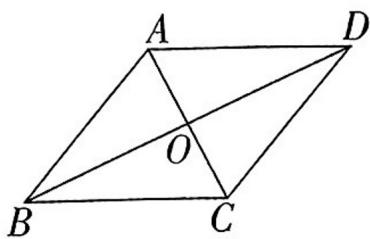

<!-- question-source:start -->
1 [2024 内蒙古通辽中考] 如图, □ABCD 的对角线 AC, BD 交于点 O, 以下条件不能证明 □ABCD 是菱形的是 ( )

A. $\angle BAC = \angle BCA$ B. $\angle ABD = \angle CBD$ C. $OA^{2} + OD^{2} = AD^{2}$ D. $AD^{2} + OA^{2} = OD^{2}$
<!-- question-source:end -->

![[Q00107374A1]]
