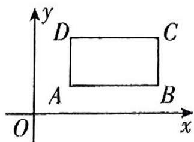

<!-- question-source:start -->
3[2024 河北中考]在平面直角坐标系中,我们把一个点的纵坐标与横坐标的比值称为该点的“特征值”. 如图,矩形 $ABCD$ 位于第一象限,其四条边分别与坐标轴平行,则该矩形四个顶点中“特征值”最小的是 ( )

A. 点 $A$ B. 点 $B$ C. 点 $C$ D. 点 $D$
<!-- question-source:end -->

![[Q00107376A1]]
