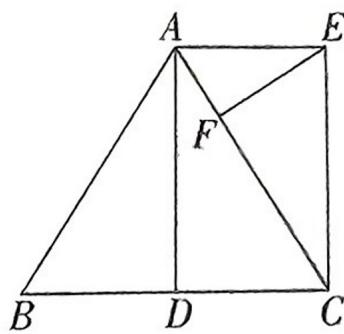

<!-- question-source:start -->
4[2024 甘肃兰州中考]如图,在 $\triangle ABC$ 中, $AB=AC,D$ 是 $BC$ 的中点, $CE//AD,AE\perp AD,EF\perp AC$ .

(1) 求证: 四边形 ADCE 是矩形;

建议用时 30 分钟 答案 D21

(2) 若 $BC = 4, CE = 3$ , 求 $EF$ 的长.

<!-- question-source:end -->

![[Q00107377A1]]
