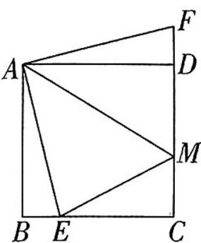
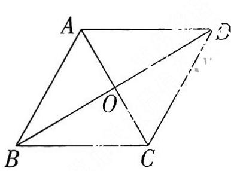

<!-- question-source:start -->
5[2024 重庆中考 B 卷]如图,在边长为 4 的正方形 ABCD 中,点 E 是 BC 上一点,点 F 是 CD 延长线上一点,连接 AE,AF,AM 平分 $\angle EAF$ 交 CD 于点 M. 若 BE=DF=1,则 DM 的长度为( )
A. 2 B. $\sqrt{5}$ C. $\sqrt{6}$ D. $\frac{12}{5}$

(第5题图)

(第6题图)
<!-- question-source:end -->

![[Q00107378A1]]
