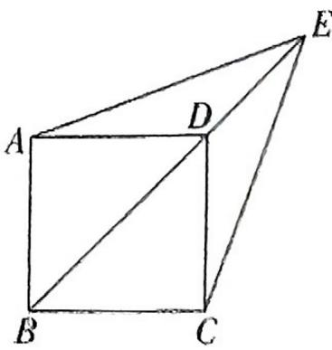

<!-- question-source:start -->
7[2024 江苏徐州中考]已知:如图,四边形 ABCD 为正方形,点 E 在 BD 的延长线上,连接 EA,EC.

(1) 求证: $\triangle EAB \cong \triangle ECB$ ;

(2) 若 $\angle AEC = 45^{\circ}$ , 求证: $DC = DE$ .

<!-- source-part:2 pages:26-50 -->
<!-- question-source:end -->

![[Q00107380A1]]
