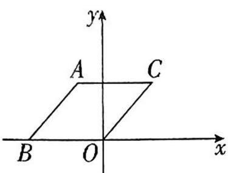
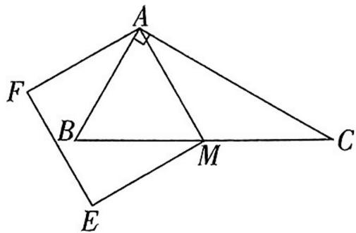

<!-- question-source:start -->
1 [2024 甘肃临夏州中考] 如图, $O$ 是坐标原点,菱形 $ABOC$ 的顶点 $B$ 在 $x$ 轴的负半轴上, 顶点 $C$ 的坐标为 $(3,4)$ , 则顶点 $A$ 的坐标为 ( )

A. $(-4,2)$ B. $(- \sqrt{3},4)$ C. $(-2,4)$ D. $(-4, \sqrt{3})$

(第1题图)

(第3题图)
<!-- question-source:end -->

![[Q00107381A1]]
