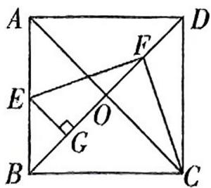
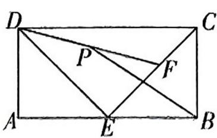

<!-- question-source:start -->
4[2024 重庆沙坪坝区质检]如图,正方形 ABCD 的对角线相交于点 O, 点 E 在 AB 边上, 点 F 在 OD 上, 过点 E 作 $EG \perp BD$ , 垂足为点 G, 若 FE = FC, $EF \perp CF$ , OF = 3, 则 BE 的长为 ( )
A. 3 B. $3\sqrt{2}$ C. $3\sqrt{3}$ D. $2\sqrt{3}$

(第4题图)

(第5题图)
<!-- question-source:end -->

![[Q00107384A1]]
