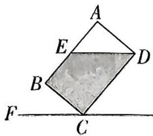
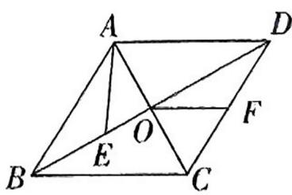

<!-- question-source:start -->
8[2025 山西太原质检]如图,矩形ABCD为一个正在倒水的水杯截面图,若杯内水面刚好经过点D(DE//CF),且 $\angle AED=50^{\circ}$ ,则水杯底面BC与水平面夹角 $\angle BCF$ 的大小为\_\_\_\_.

(第8题图)

(第9题图)
<!-- question-source:end -->

![[Q00107387A1]]
