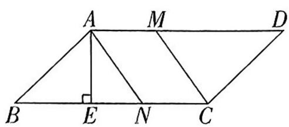
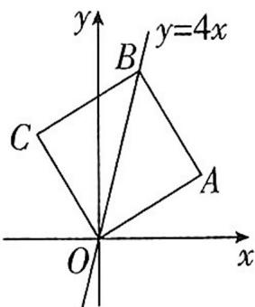

<!-- question-source:start -->
12[2024 山东威海文登区期中]如图,平行四边形 $ABCD$ 中, $AD = 9 \mathrm{~cm}, CD = 3\sqrt{2} \mathrm{~cm}, \angle B = 45^{\circ}, AE \perp BC$ , 点 $M, N$ 分别以 $A, C$ 为起点, 以 $1 \mathrm{~cm/s}$ 的速度沿 $AD, CB$ 边运动, 连接 $AN, CM$ . 设点 $M, N$ 运动的时间为 $t \mathrm{~s}(0 \leqslant t \leqslant 6)$ , 作 $MP \perp BC$ 于 $P, NQ \perp AD$ 于 $Q$ , 当 $t =$ \_\_\_\_时, 四边形 $MPNQ$ 为正方形.

(第 12 题图)
(第 13 题图)
<!-- question-source:end -->

![[Q00107391A1]]
