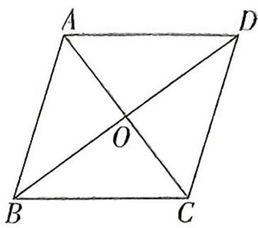
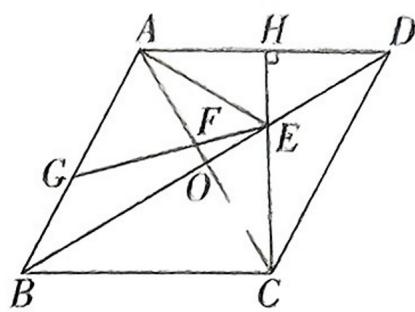

<!-- question-source:start -->
14 [2024 黑龙江哈尔滨中考] 四边形 $ABCD$ 的对角线 $AC, BD$ 相交于点 $O, AD \parallel BC, OA = OC$ , $AB = BC$ .

(1) 如图 (1), 求证: 四边形 $ABCD$ 是菱形;

(2) 如图 (2), $AB = AC, CH \perp AD$ 于点 $H$ , 交 $BD$ 于点 $E$ , 连接 $AE$ , 点 $G$ 在 $AB$ 上, 连接 $EG$ 交 $AC$ 于点 $F$ , 若 $\angle FEC = 75^\circ$ , 在不添加任何辅助线的情况下,直接写出四条与线段 CE 相等的线段(线段 CE 除外).

图(1)

图(2)
<!-- question-source:end -->

![[Q00107393A1]]
