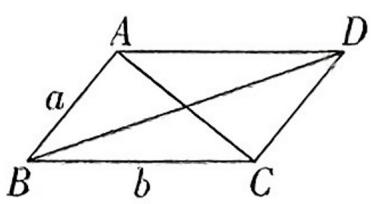
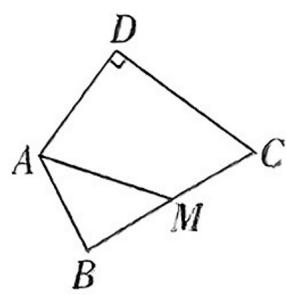

<!-- question-source:start -->
15[2025 江西抚州期中]【特例感知】

(1)①在正方形ABCD中,设其边长为a,则对角线AC,BD和a的数量关系为 $AC^{2}+BD^{2}=$ \_\_\_\_;
②在菱形ABCD中,设其边长为a,则对角线AC,BD和a的数量关系为 $AC^{2}+BD^{2}=$ \_\_\_\_;
③在矩形ABCD中,设AB=a,BC=b,则对角线AC,BD和a,b的数量关系为 $AC^{2}+BD^{2}=$ \_\_\_\_.
【规律探究】(2)如图(1),在□ABCD中,设AB=a,BC=b,猜想对角线AC,BD和a,b的数量关系为 $AC^{2}+BD^{2}=$ \_\_\_\_,并证明你的猜想.
【知识应用】(3)如图(2),在四边形ABCD中,AB=5,BC=9,CD=8,AD=6,∠ADC=90°,点M为BC的中点,求AM的长.

图(1)

图(2)
<!-- question-source:end -->

![[Q00107394A1]]
