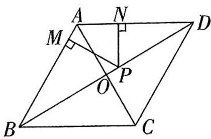
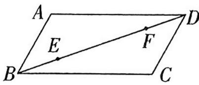

<!-- question-source:start -->
6[2024 辽宁锦州期中]如图,在菱形 $ABCD$ 中, $\angle ABC = 60^{\circ}$ ,对角线 $AC,BD$ 相交于点 $O,P$ 是对角线 $BD$ 上的一动点,且 $PM \perp AB$ 于点 $M,PN \perp AD$ 于点 $N$ .有以下结论:① $\triangle ABC$ 为等边三角形;② $OB = \sqrt{3}OA$ ;③ $\angle MPN = 60^{\circ}$ ;④ $PM+PN=\frac{1}{2}BD$ .其中正确的有 ( )

A.1个 B.2个 C.3个 D.4个

(第6题图)

(第7题图)
<!-- question-source:end -->

![[Q00107768A1]]
