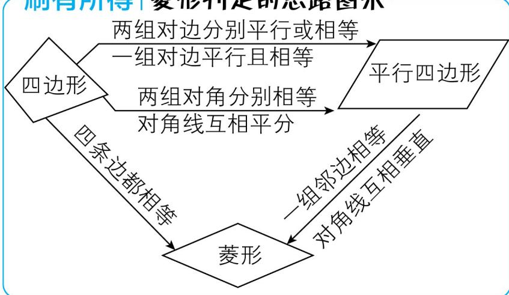

> [!success]- 必刷题
>
> > [!success] **【答案】** D
>
> > [!note]- **【解析】**
> > ∵ $\angle BAC = \angle BCA, \therefore AB = BC,$ ∴ □ABCD 是菱形, 故选项 A 不符合题意.
> >
> > ∵ 四边形 ABCD 是平行四边形, ∴ $AD \parallel BC,$ ∴ $\angle ADB = \angle CBD.$ ∵ $\angle ABD = \angle CBD,$ ∴ $\angle ABD = \angle ADB, \therefore AB = AD, \therefore$ □ABCD 是菱形, 故选项 B 不符合题意. ∵ $OA^{2} + OD^{2} = AD^{2},$ ∴ $\angle AOD = 90^{\circ}, \therefore AC \perp BD, \therefore$ □ABCD 是菱形, 故选项 C 不符合题意. ∵ $AD^{2} + OA^{2} = OD^{2},$ ∴ $\angle OAD = 90^{\circ}, \therefore OA \perp AD,$ 不能证得 □ABCD 是菱形, 故选项 D 符合题意. 故选 D.
> >
> > ## 刷有所得|菱形判定的思路图示
> >
> > 
