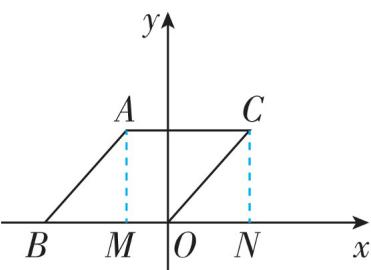

> [!success]- 必刷题
>
> > [!success] **【答案】** C
>
> > [!note]- **【解析】**
> > 如图, 过 $C$ 作 $CN \perp x$ 轴于 $N$ , 过 $A$ 作 $AM \perp x$ 轴于 $M$ . $\because$ 点 $C$ 的坐标为 $(3, 4)$ , $\therefore ON = 3, CN = 4,$ $\therefore OC = \sqrt{ON^2 + CN^2} = 5.$ $\because$ 四边形 $ABOC$ 是菱形 $BO, \therefore$ 点 $A$ 的坐标为 $(-2, -1)$ .
> >
> > 
> >
> > ∵ 四边形 ABOC 是菱形, ∴ AC = OC = 5, AC // BO, ∴ 点 A 的坐标为 $(-2, 4)$ .
> >
> > 故选 **C**.
