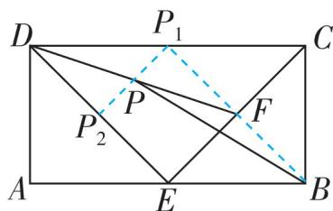

> [!success]- 必刷题
>
> > [!success] **【答案】** C
>
> > [!note]- **【解析】**
> > 如图, 当点 F 与点 C 重合时, 点 P 在 $P_{1}$ 处, $CP_{1} = DP_{1}$ , 当点 F 与点 E 重合时, 点
> >
> > 
> >
> > P 在 $P_{2}$ 处, $EP_{2}=DP_{2}$ , ∴ 点 P 的运动轨迹是线段 $P_{1}P_{2}$ , ∴ 当 $BP \perp P_{1}P_{2}$ 时, PB 取得最小值, 此时垂足为 $P_{1}$ , ∴ BP 的最小值为 $BP_{1}$ 的长. ∵ $CP_{1}=BC=1$ , ∠ $BCP_{1}=90^{\circ}$ , ∴ $BP_{1}=\sqrt{2}$ , ∴ PB 的最小值是 $\sqrt{2}$ . 故选 C.
> >
> > 思路分析
> > 由菱形的性质得 $AC \perp BD$ ,
> > OA = OC = 4,
> > OB = OD, 再由勾股定理求AE, BC 的长,
> > 然后由中位线定理即可求解.
