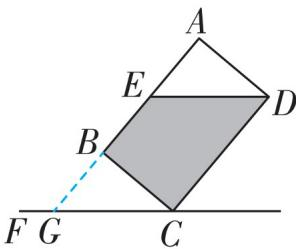

> [!success]- 必刷题
>
> > [!success] **【答案】** 40°
>
> > [!note]- **【解析】**
> > 延长 AB 交 CF 示. ∵ DE // CF, ∠AED = 50°, ∴ ∠AGC = ∠AED = 50°. ∵ 四边形 ABCD 为矩形, ∴ ∠ABC = 90°, ∴ ∠CBG = 180° - ∠ABC = 90°, ∴ ∠BCF = 90° - 50° = 40°
> >
> > 
> >
> > $$
