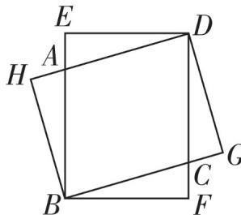
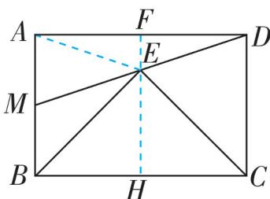
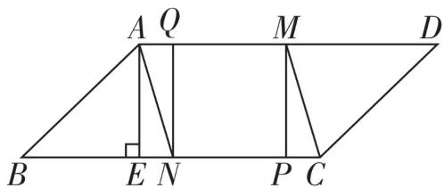

> [!success]- 必刷题
>
> > [!success] **【答案】** $2 \sqrt{5}$
>
> > [!note]- **【解析】**
> > ∵ 四边形 $ABCD$ 是菱形, $\therefore AC \perp BD, AO = CO = 4, BO = DO, \therefore AE = \sqrt{AO^2 + EO^2} = \sqrt{16 + 9} = 5, \therefore BE = AE = 5, \therefore BO = 8, \therefore BC = \sqrt{BO^2 + CO^2} = \sqrt{64 + 16} = 4 \sqrt{5}$ . ∵ 点 $F$ 为 $CD$ 的中点, $BO = DO, \therefore OF = \frac{1}{2} BC = 2 \sqrt{5}$ , 故答案为 $2 \sqrt{5}$ .
> >
> > 
> >
> > 10.25 【解析】如图,由题意得 $\angle G=90^{\circ},DG=DE=6,$ $BG//DH,BE//DF,BG=8,$ $\therefore$ 四边形ABCD是平行四边形，∴平行四边形ABCD的面积为 $AD\cdot DG=CD\cdot DE,\therefore AD=CD,\therefore$ 平行四边形AB-CD是菱形，∴ $CD=BC=AB=AD.$ 设 $CD=BC=x$ ,则 $CG=8-x$ .在Rt△CDG中,由勾股定理得 $6^{2}+(8-x)^{2}=x^{2}$ ,解得 $x=\frac{25}{4},\therefore CD=\frac{25}{4},\therefore$ 菱形ABCD的周长为 $4CD=25$ ,即重叠部分的四边形周长是25,故答案为25.
> >
> > 11.4 【解析】如图, 连接 AE, 过点 E 作 $EF \perp AD$ 于 F, 并延长 FE, 交 BC 于点 H. ∵ 四边形 ABCD
> >
> > 
> >
> > 是矩形, $BC = 6$ , $\therefore \angle BAD = \angle ADC = \angle ABC = 90^{\circ}$ , $AD = BC = 6$ , $AB = DC$ , $AD \parallel BC$ , $\therefore \angle AFH = \angle BHF = 90^{\circ}$ , $\therefore$ 四边形 $ABHF$ 是矩形. $\because E$ 为 $MD$ 的中点, $\therefore AE = DE$ , $\therefore AF = DF$ , $\therefore BH = CH$ , $EF = \frac{1}{2} AM$ . $\because \angle BEC = 90^{\circ}$ ,$\therefore EH = \frac{1}{2} BC = 3.\because M$ 为 $AB$ 的中点， $\therefore AM = \frac{1}{2} AB,\therefore EF = \frac{1}{4} AB,\therefore EH = \frac{3}{4} AB = 3,\therefore AB = 4,$ 故答案为4.
> >
> > 12.4.5 或 1.5 【解析】如图所示, ∵ 四边形▶思路分析
> >
> > ABCD 是平行四边形, $\therefore AB = CD = 3\sqrt{2}\mathrm{cm},$ $AD = BC = 9\mathrm{cm}.$
> >
> > 
> >
> > 先证明四边形MPNQ为矩形,则当 $QM = QN$ 时,四边形MPNQ为正方形.根据 $QM = QN$ 列出方程 $|2t - 6| = 3$ ，解方程即可.
> >
> > 在 Rt $\triangle ABE$ 中, $\angle AEB = 90^{\circ}$ , $\angle B = 45^{\circ}$ , $\therefore \triangle ABE$ 是等腰直角三角形, $\therefore AB = \sqrt{2} AE$ , $\therefore AE = 3\mathrm{cm}$ . $\because MP \perp BC, NQ \perp AD, QM // NP$ , $\therefore$ 四边形 $MPNQ$ 为矩形, $\therefore$ 当 $QM = QN$ 时, 四边形 $MPNQ$ 为正方形. 由题意得 $AM = CN = t\mathrm{cm}$ , 且 $BE = 3\mathrm{cm}$ , $\therefore$ 易得 $AQ = EN = BC - BE - CN = 9 - 3 - t = (6 - t)\mathrm{cm}$ , $\therefore QM = AM - AQ = |t - (6 - t)| = |2t - 6|\mathrm{cm}$ . $\because QN = AE = 3\mathrm{cm}, \therefore |2t - 6| = 3$ , 解得 $t = 4.5$ 或 $t = 1.5$ . 故当 $t = 4.5$ 或 1.5 时, 四边形 $MPNQ$ 为正方形. 故答案为 4.5 或 1.5.
> >
> > ## 关键点拨
