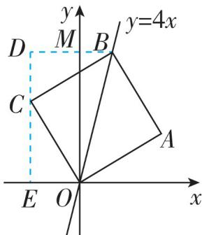

> [!success]- 必刷题
>
> > [!success] **【答案】** $(-3,5)$
>
> > [!note]- **【解析】**
> > ∵正方形OABC的面积是
> > 34, ∴ ∠BCO = 90°, OC = BC = √34, ∴ OB = √OC² + BC² = √(√34)² + (√34)² = √34 + 34 = 2√17. ∵点B在直线y=4x上, ∴设B(a,4a)(a>0), ∴OB = √a² + (4a)² = √17 a = 2√17, ∴a=2, ∴B(2,8). 过点B作BM⊥y轴于点M, 过点C作CE⊥x轴于点E, 延长
> >
> > (2) 利用菱形的性质, 等边三角形的判定与性质, 等腰三角形的判定与性质解答即可.
> >
> > $EC$ ，交 $BM$ 的延长线于点 $D$ ，如图，∴四边形OEDM是矩形， $\therefore \angle BDC = \angle CEO =$ $90^{\circ}$ ， $OM = DE$ ， $\angle OCE +$ $\angle COE = 90^{\circ}.\because \angle BCO =$ $90^{\circ},\therefore \angle BCD + \angle OCE =$
> >
> > 
> >
> > $90^{\circ}, \therefore \angle BCD = \angle COE.$ 又 $\because BC = CO,$ $\therefore \triangle DBC \cong \triangle ECO(AAS), \therefore DB = EC, DC = EO.$ $\because B(2,8), \therefore MB = 2, OM = DE = 8.$ 设 $OE = DC = x, \therefore DB = OE + MB = x + 2, EC = DE - DC = 8 - x.$ $\because DB = EC, \therefore x + 2 = 8 - x, \therefore x = 3,$ $\therefore OE = 3, CE = 5.$ $\because$ 点 $C$ 在第二象限， $\therefore C(-3,5)$ . 故答案为 $(-3,5)$ .
