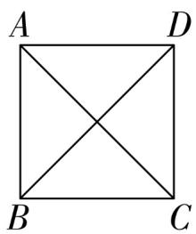
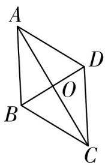
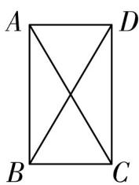
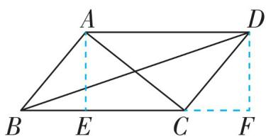
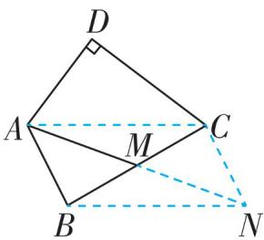

> [!success]- 必刷题
>
> > [!success] **【答案】** A
>
> > [!note]- **【解析】**
> > 【解】(1)①如图(1)，∵四边形ABCD是正方形，∴AC=BD,AB=AD=BC=CD=a,∠ABC=∠BCD=90°,∴AC²=AB²+BC²=2a²,BD²=BC²+CD²=2a²,∴AC²+BD²=4a².故答案为4a².
> >
> > 
> >
> > 
> > 图(1)
> >
> > 
> > 图(2)
> > 图(3)
> > - **②**：如图(2)，∵四边形ABCD是菱形，∴AC⊥BD,OA=OC,OB=OD,AB=AD=BC=CD=a, ∴∠AOB=90°, ∴OA²+OB²=a², ∴(2OA)²+(2OB)²=4a², ∴AC²+BD²=4a². 故答案为4a².
> > - **③**：如图(3)，∵四边形ABCD是矩形，∴AC=BD, AB=CD=a, AD=BC=b, ∠ABC=∠BCD=90°, ∴AC²=AB²+BC²=a²+b², BD²=BC²+CD²=a²+b², ∴AC²+BD²=2a²+2b². 故答案为2a²+2b².
> >
> > (2)猜想：AC²+BD²=2a²+2b². 证明：如图(4)，分别过点A,D作AE⊥BC于E,DF⊥BC交BC延长线于F, ∴∠AEB=∠DFC=
> >
> > <!-- source-part:2 pages:26-50 -->
> >
> > $90^{\circ}$ . $\because$ 四边形 $ABCD$ 是平行四边形, $\therefore AB = DC, AB // CD, \therefore \angle ABE = \angle DCF$ . 在 $\triangle ABE$ 和 $\triangle DCF$ 中, $\left\{ \begin{array}{l} \angle AEB = \angle DFC, \\ \angle ABE = \angle DCF, \therefore \triangle ABE \cong AB = DC, \end{array} \right.$ $\triangle DCF(AAS), \therefore BE = CF, AE = DF$ . 设 $BE = CF = m, AE = DF = h$ , 则 $CE = b - m, BF = b + m$ . 在 Rt $\triangle AEC$ 中, $AC^{2} = AE^{2} + CE^{2} = h^{2} + (b - m)^{2} = h^{2} + b^{2} - 2bm + m^{2}$ ; 在 Rt $\triangle BDF$ 中, $BD^{2} = DF^{2} + BF^{2} = h^{2} + (b + m)^{2} = h^{2} + b^{2} + 2bm + m^{2}, \therefore AC^{2} + BD^{2} = 2h^{2} + 2b^{2} + 2m^{2}$ . $\because$ 在 Rt $\triangle ABE$ 中, $AB^{2} = AE^{2} + BE^{2} = h^{2} + m^{2}, \therefore h^{2} + m^{2} = a^{2}, \therefore AC^{2} + BD^{2} = 2(h^{2} + m^{2}) + 2b^{2} = 2a^{2} + 2b^{2}$ .
> >
> > 
> >
> > 
> > 图(4)
> > 图(5)
> >
> > (3)如图(5)，连接 $AC$ ，延长 $AM$ 至点 $N$ ，使 $MN = AM$ ，连接 $BN,CN.$ ∵点 $M$ 为 $BC$ 的中点，∴ $BM = MC,\therefore$ 四边形ABNC是平行四边形，∴由(2)的结论可得 $BC^2 +AN^2 = 2AB^2+$ $2AC^{2}:\because \angle D = 90^{\circ},CD = 8,AD = 6,\therefore AC =$ $\sqrt{AD^2 + CD^2} = \sqrt{6^2 + 8^2} = 10.\therefore AB = 5,BC = 9,$ $\therefore 9^{2} + AN^{2} = 2\times 5^{2} + 2\times 10^{2},\therefore AN^{2} = 169,$ $\therefore AN = 13$ （负值已舍去），∴ $AM = \frac{1}{2} AN = \frac{13}{2}.$
> >
> > ## 第二章 一元二次方程
> >
> > ## 1 认识一元二次方程
> >
> > ## 课时1 认识一元二次方程
> >
> > ## 刷基础
> >
> > 1. A 【解析】 $2x^{2}-\frac{1}{3x}=1$ 不是整式方程,故①不是一元二次方程; $2x^{2}-5xy+y^{2}=0$ 中含有两个未知数,故②不是一元二次方程; $7x^{2}+1=0$ 符合一元二次方程的定义,故③是一元二次方程; $ax^{2}+bx+c=0$ ,当a=0时,方程化为 $bx+c=0$ ,不含二次项,故④不是一元二次方程;将 $x^{2}+2x=x^{2}-1$ 整理,得2x=-1,不含二次项,故⑤不是一元二次方程.综上,只有③是一元二次方程.故选A.
> >
> > 2. $\neq \pm 3 = 3$ 【解析】关于 $x$ 的方程 $(a^2 - 9) \cdot x^2 - (a + 3)x - 1 = 0$ , 当 $a^2 - 9 \neq 0$ , 即 $a \neq \pm 3$ 时, 是一元二次方程; 当 $\left\{ \begin{array}{l} a^2 - 9 = 0, \\ a + 3 \neq 0, \end{array} \right.$ 即 $a = 3$ 时, 是一元一次方程. 故答案为 $\neq \pm 3, = 3$ .
> >
> > 3. B 【解析】 $x^{2}+x=2(x-3)$ ，整理得 $x^{2}-x+6=0$ ，∴一次项系数和常数项分别为 -1, 6. 故选 B.
> >
> > 4. $-y^{2}+3y-6=0$ 【解析】根据题意, 得未知数为 $y$ , 二次项系数是 -1 , 一次项系数是 3 , 常数项是 -6 的一元二次方程的一般形式为 $-y^{2}+3y-6=0$ .
> >
> > 5. C 【解析】已知小圆形场地的半径为 $x \mathrm{~m}$ , 则
> >
> > ## 刷有所得
> >
> > 一元二次方程必须满足四个条件:(1)未知数的最高次数是2;(2)整理后二次项系数不为0;(3)是整式方程;(4)含有一个未知数.
> >
> > 易错警示
> > 在确定一元二次方程中各项系数及常数项时,注意要先将方程整理成一元二次方程的一般形式,即 $ax^{2}+bx+c=0$ ,然后再确定各项系数及常数项.
> >
> > 大圆形场地的半径为 $(x + 5)\mathrm{m}$ , 根据题意可得 $\pi (x + 5)^2 = 2\pi x^2$ . 故选 C.
> >
> > 6.【解】(1)设十位数字为 $x$ , 则个位数字为 $x + 3$ , 百位数字为 $x + 2$ . 根据题意得 $[100(x + 2) + 10x + (x + 3)] - 9[(x + 3)^{2} + x^{2} + (x + 2)^{2}] = 20$ , 化为一般形式为 $9x^{2} - 7x - 22 = 0$ .
> >
> > (2)设其中一条直角边的长为 $x \mathrm{~cm}$ , 则另一条直角边的长为 $(14 - x) \mathrm{cm}$ . 根据题意, 得 $\frac{1}{2} x (14 - x) = 24$ , 整理, 得 $x^{2} - 14x + 48 = 0$ .
> >
> > ## 刷易错·
> >
> > 7.【解】不正确. 正确解题过程如下:一元二次方程整理后得 $x^{2}+(a-1)x+4-a=0$ . 由题意得 $a-1=4$ , 解得 $a=5$ , 所以 $4-a=-1$ , 所以常数项是 $-1$ .
> >
> > ## 课时 2 一元二次方程的解及其估算
> >
> > ## 刷基础
> >
> > 1. B 【解析】当 $x = -1$ 时, $ax^2 + bx + c = a \times (-1)^2 + b \times (-1) + c = a - b + c$ . $\because$ 关于 $x$ 的一元二次方程 $ax^2 + bx + c = 0$ 满足 $a - b + c = 0$ , $\therefore$ 此方程必有一个根为 $x = -1$ . 故选 B.
> >
> > 2. D 【解析】: 关于 $x$ 的一元二次方程 $x^{2} - ax + 6 = 0$ 的一个根是 $2, \therefore 2^{2} - 2a + 6 = 0$ , 解得 $a = 5$ . 故选 D.
> >
> > 3. D 【解析】∵ 关于 x 的一元二次方程 $ax^{2} + bx = c (ac \neq 0)$ 的一个实数根为 2022,
> >
> > $90^{\circ}$ . $\because$ 四边形 $ABCD$ 是平行四边形, $\therefore AB = DC, AB // CD, \therefore \angle ABE = \angle DCF$ . 在 $\triangle ABE$ 和 $\triangle DCF$ 中, $\left\{ \begin{array}{l} \angle AEB = \angle DFC, \\ \angle ABE = \angle DCF, \therefore \triangle ABE \cong AB = DC, \end{array} \right.$ $\triangle DCF(AAS), \therefore BE = CF, AE = DF$ . 设 $BE = CF = m, AE = DF = h$ , 则 $CE = b - m, BF = b + m$ . 在 Rt $\triangle AEC$ 中, $AC^{2} = AE^{2} + CE^{2} = h^{2} + (b - m)^{2} = h^{2} + b^{2} - 2bm + m^{2}$ ; 在 Rt $\triangle BDF$ 中, $BD^{2} = DF^{2} + BF^{2} = h^{2} + (b + m)^{2} = h^{2} + b^{2} + 2bm + m^{2}, \therefore AC^{2} + BD^{2} = 2h^{2} + 2b^{2} + 2m^{2}$ . $\because$ 在 Rt $\triangle ABE$ 中, $AB^{2} = AE^{2} + BE^{2} = h^{2} + m^{2}, \therefore h^{2} + m^{2} = a^{2}, \therefore AC^{2} + BD^{2} = 2(h^{2} + m^{2}) + 2b^{2} = 2a^{2} + 2b^{2}$ .
> >
> > 
> >
> > 
> > 图(4)
> > 图(5)
> >
> > (3)如图(5)，连接 $AC$ ，延长 $AM$ 至点 $N$ ，使 $MN = AM$ ，连接 $BN,CN.$ ∵点 $M$ 为 $BC$ 的中点，∴ $BM = MC,\therefore$ 四边形ABNC是平行四边形，∴由(2)的结论可得 $BC^2 +AN^2 = 2AB^2+$ $2AC^{2}:\because \angle D = 90^{\circ},CD = 8,AD = 6,\therefore AC =$ $\sqrt{AD^2 + CD^2} = \sqrt{6^2 + 8^2} = 10.\therefore AB = 5,BC = 9,$ $\therefore 9^{2} + AN^{2} = 2\times 5^{2} + 2\times 10^{2},\therefore AN^{2} = 169,$ $\therefore AN = 13$ （负值已舍去），∴ $AM = \frac{1}{2} AN = \frac{13}{2}.$
> >
> > ## 第二章 一元二次方程
> >
> > ## 1 认识一元二次方程
> >
> > ## 课时1 认识一元二次方程
