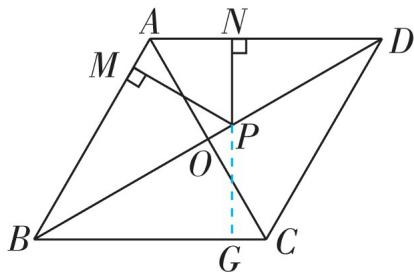

> [!success]- 必刷题
>
> > [!success] **【答案】** D
>
> > [!note]- **【解析】**
> > ∵ 四边形 ABCD 是菱形, ∴ AB =
> >
> > BC. 又∵ $\angle ABC = 60^{\circ}$ ,
> > ∴ $\triangle ABC$ 为等边三角形, 故①正确. ∵ 四边形 ABCD 是菱形,
> > ∴ $AC \perp BD$ , $\angle ABO =$
> >
> > 
> >
> > $\angle CBO = 30^{\circ}$ , $\therefore OB = \sqrt{3}OA$ , 故②正确. $\because PM \perp AB, PN \perp AD, \therefore \angle AMP = \angle ANP = 90^{\circ}$ . $\because AD \parallel BC, \angle ABC = 60^{\circ}, \therefore \angle BAD = 120^{\circ}$ , $\therefore \angle MPN = 60^{\circ}$ , 故③正确. 如图, 延长 NP 交 BC 于点 G. $\because AD \parallel BC, PN \perp AD, \therefore PG \perp BC$ . $\because PM \perp AB, BP$ 平分 $\angle ABC, \therefore PM = PG$ , $\therefore PM + PN = PG + PN = NG$ . $\because AD \parallel BC$ , $\therefore \angle PBG = \angle PDN = 30^{\circ}, \therefore PB = 2PG, PD = 2PN$ , $\therefore PM + PN = PG + PN = \frac{1}{2}PB + \frac{1}{2}PD = \frac{1}{2}(PB + PD) = \frac{1}{2}BD, \therefore PM + PN = \frac{1}{2}BD$ , 故④正确. 综上所述, 正确的有 4 个. 故选 D.
> >
> > $$
> > N F
> > $$
