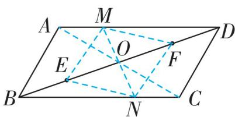

> [!success]- 必刷题
>
> > [!success] **【答案】** C
>
> > [!note]- **【解析】**
> > 如图, 连接 $AC, MN, ME, MF, NE$ ,
> >
> > $$
> > A C, M N, B D
> > $$
> >
> > 
> >
> > 关键点拨
> > 根据对角线的情况进行判断, EF 和 MN 的长度都有无数种情况, 所以它们有无数种情况互相平分, 无数种情况相等且互相平分, 无数种情况互相垂直平分, 对角线互相垂直平分且相等的情况只有一种.
> >
> > 形, $\therefore OA = OC, OB = OD$ . $\because BE = DF, \therefore OE = OF, \therefore$ 只要 $OM = ON$ , 那么四边形 MENF 就是平行四边形. $\because$ 点 $E, F$ 是 $BD$ 上的动点, $\therefore$ 存在无数个平行四边形 MENF, 故①正确. 只要
> >
> > $MN = EF, OM = ON$ , 那么四边形 $MENF$ 就是矩形. $\because$ 点 $E, F$ 是 $BD$ 上的动点, $\therefore$ 存在无数个矩形 $MENF$ , 故②正确. 只要 $MN \perp EF, OM = ON$ , 那么四边形 $MENF$ 就是菱形. $\because$ 点 $E, F$ 是 $BD$ 上的动点, $\therefore$ 存在无数个菱形 $MENF$ , 故③正确. 只要 $MN = EF, MN \perp EF, OM = ON$ , 那么四边形 $MENF$ 就是正方形, 而符合要求的正方形只有一个, 故④错误.
> >
> > 故选 **C**.
