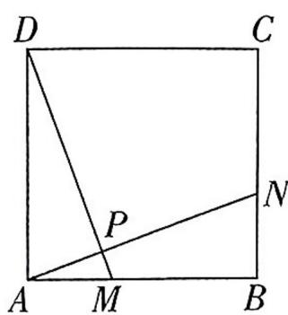

<!-- question-source:start -->
1 [2025 辽宁抚顺期末, 中] 如图, 正方形 $ABCD$ 中, 点 $M, N$ 分别在 $AB, BC$ 上, 且 $BM = CN$ , $AN$ 与 $DM$ 相交于点 $P$ .

(1) 求证: $\triangle ABN \cong \triangle DAM$ ;

(2)求 $\angle APM$ 的大小.

<!-- question-source:end -->

![[Q00107361A1]]
