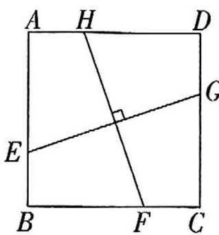

<!-- question-source:start -->
2[2025 吉林长春期末, 中]如图, 在正方形 $ABCD$ 中, 点 $E, F, G, H$ 分别在线段 $AB, BC, CD, DA$ 上, 且 $EG \perp FH$ . 试猜想 $\frac{EG}{FH}$ 的值, 并证明你的猜想.

<!-- question-source:end -->

![[Q00107362A1]]
