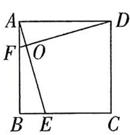
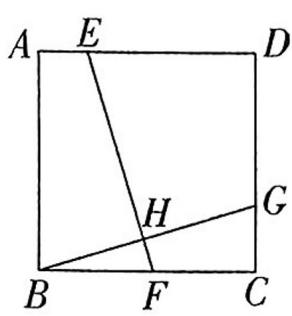
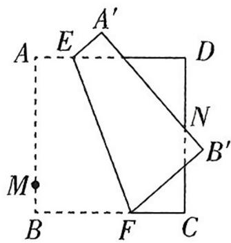

<!-- question-source:start -->
3[2025 浙江宁波期末, 中](1)如图(1), 在正方形ABCD中, AE, DF相交于点O, 且AE⊥DF, 则AE和DF的数量关系为\_\_\_\_.

(2)如图(2),在正方形ABCD中,E,F,G分别是边AD,BC,CD上的点,BG⊥EF,垂足为H.求证:EF=BG.

建议用时 60 分钟 答案 D18

(3)如图(3),在正方形ABCD中,E,F,M分别是边AD,BC,AB上的点,AE=2,BF=5,BM=1,将正方形沿EF折叠,点M的对应点恰好与CD边上的点N重合,求CN的长度.

图(1)

图(2)

图(3)
<!-- question-source:end -->

![[Q00107363A1]]
