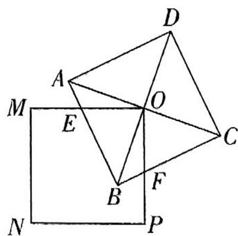

<!-- question-source:start -->
4.[2025 广东珠海期中, 中]如图, 正方形 OPNM 和正方形 ABCD 全等, 边长均为 3, AC 与 BD 交于点 O, 正方形 OPNM 绕点 O 旋转, OM 交 AB 于点 E, OP 交 BC 于 F.

(1)在上述旋转过程中,判断 OE 与 OF 有怎样的数量关系,并证明;

(2) 请直接写出四边形 OEBF 的面积为 \_\_\_\_.

<!-- question-source:end -->

![[Q00107364A1]]
