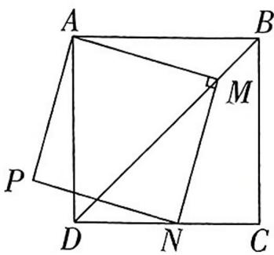

<!-- question-source:start -->
5[2025 陕西咸阳期中, 中]如图, 在正方形 $ABCD$ 中, 点 $M$ 是对角线 $BD$ 上的一点, 连接 $AM$ , 过点 $M$ 作 $MN \perp AM$ , 交 $CD$ 于点 $N$ , 以 $AM, MN$ 为邻边作矩形 $AMNP$ .

(1)求证:矩形 AMNP 是正方形.

(2) 若点 $N$ 为 $CD$ 的中点, 且 $AD = 8$ , 求正方形 $AMNP$ 的面积.

<!-- question-source:end -->

![[Q00107365A1]]
