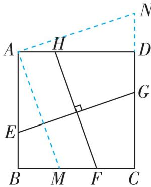

> [!success]- 必刷题
>
> > [!success] **【答案】** (1)
>
> > [!note]- **【解析】**
> > 【证明】∵ 四边形 ABCD 是正方形, ∴ AB =
> >
> > $AD = BC, \angle DAM = \angle ABN = 90^{\circ}.\because BM = CN,$ $\therefore BC - CN = AB - BM$ , 即 $BN = AM$ . 在 $\triangle ABN$ 和 $\triangle DAM$ 中, $\left\{ \begin{array}{l}AB = AD,\\ \angle ABN = \angle DAM,\\ BN = AM, \end{array} \right.$ $\therefore \triangle ABN \cong \triangle DAM(SAS)$ . (2)【解】由（1）知 $\triangle ABN \cong \triangle DAM,$ $\therefore \angle MAP = \angle ADM, \therefore \angle MAP + \angle AMP =$ $\angle ADM + \angle AMP = 180^{\circ} - \angle DAM = 90^{\circ},$ $\therefore \angle APM = 180^{\circ} - (\angle MAP + \angle AMP) = 90^{\circ}.$ 【解] $\frac{EG}{FH} = 1$ , 证明: 如图, 过点 $A$ 作 $AM // HF$ 交
> >
> > BC 于点 M, 作 AN // EG 交 CD 的延长线于点 N, ∴ 易得 AM = HF, AN = EG. ∵ 四边形 ABCD 是正方形,
> > ∴ AB = AD, ∠ABM = ∠BAD =
> > ∠ADN = 90°. ∵ EG ⊥ FH,
> >
> > 
> >
> > $\therefore AM \perp AN, \therefore \angle NAM = 90^{\circ}, \therefore \angle BAM = \angle DAN.$ 在 $\triangle ABM$ 和 $\triangle ADN$ 中， $\left\{ \begin{array}{l} \angle BAM = \angle DAN, \\ AB = AD, \\ \angle ABM = \angle ADN, \end{array} \right.$ ∴ $\triangle ABM \cong \triangle ADN(\mathrm{ASA})$ ， $\therefore AM = AN,$ 即 $EG = FH, \therefore \frac{EG}{FH} = 1.$
