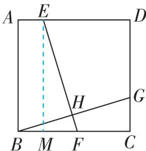
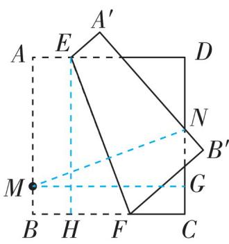
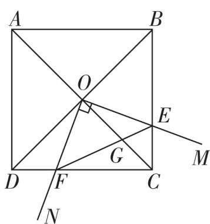

> [!success]- 必刷题
>
> > [!success] **【答案】** AE = DF
>
> > [!note]- **【解析】**
> > 【证明】如图(1), 过点 E 作 $EM \perp BC$ 于点 M, 则四边形 ABME 为矩形, ∴ AB = EM. 在正方形 ABCD 中, AB = BC, ∴ EM = BC.
> >
> > 
> > 图(1)
> >
> > $$
> > \because E M \perp B C, \therefore \angle M E F +
> > $$
> >
> > $\angle EFM = 90^{\circ}.\because BG \perp EF, \therefore \angle CBG + \angle EFM = 90^{\circ}, \therefore \angle CBG = \angle MEF.$ 在 $\triangle BCG$ 和 $\triangle EMF$ 中， $\left\{ \begin{array}{l} \angle CBG = \angle MEF, \\ BC = EM, \\ \angle C = \angle EMF = 90^{\circ}, \end{array} \right.$ $\therefore \triangle BCG \cong \triangle EMF(\mathrm{ASA}), \therefore BG = EF.$
> >
> > (3)【解】如图(2)，连接MN.∵M,N关于EF对称，∴MN⊥EF.过点E作EH⊥BC于点H,过点M作MG⊥CD于点G,则易知EH⊥MG.同(2)可得△EHF≌
> >
> > 
> > 图(2)
> >
> > $\triangle MGN, \therefore NG = HF. \because AE = 2, BF = 5, \therefore NG = HF = BF - BH = BF - AE = 5 - 2 = 3.$ 又 $\because GC = MB = 1, \therefore NC = NG + CG = 3 + 1 = 4.$
> >
> > 大招解读|对角互补模型如图,在正方形 ABCD 中,点 O 是对角线 AC,BD 的交点,过点 O 作射线 OM,ON,分别交 BC,CD 于点 E,F,且 $\angle EOF = 90^{\circ}$ , OC,EF 交于点 G.
> >
> > 
> >
> > 结论:① $\triangle COE \cong \triangle DOF$ ;
> > - **②**：$\triangle OBE \cong \triangle OCF$ ;
> > - **③**：$\triangle OEF$ 是等腰直角三角形;
> > - **④**：四边形 CEOF 的面积为正方形 ABCD 面积的 $\frac{1}{4}$ .
> >
> > ## 关键点拨
> >
> > (2) 由(1)得 $\triangle AOE$ 与 $\triangle BOF$ 全等, 将四边形 $OEBF$ 的面积转化为 $\triangle OAB$ 的面积是本题解题关键.
