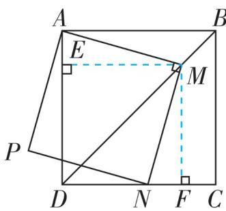
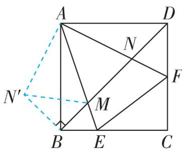
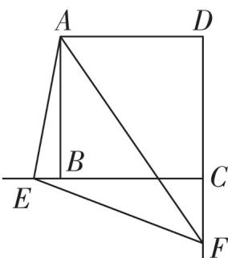

> [!success]- 必刷题
>
> > [!success] **【答案】** (1)
>
> > [!note]- **【解析】**
> > 【证明】如图,过点 M 作 $ME \perp AD$ 于点 E,
> >
> > $MF \perp CD$ 于点 $F$ . $\because$ 四边形 $ABCD$ 是正方形， $\therefore \angle ADC = 90^{\circ}, \angle MDA = \angle MDC = 45^{\circ}.\because ME \perp AD,$ $MF \perp CD, \therefore ME = MF.$
> >
> > 
> >
> > $\because \angle MED = \angle MFD = \angle EDF = 90^{\circ}, \therefore$ 四边形 $EMFD$ 是正方形, $\therefore \angle EMF = 90^{\circ} = \angle AMN,$ $\therefore \angle AME = \angle NMF.$
> >
> > 在 $\triangle AME$ 和 $\triangle NMF$ 中， $\left\{ \begin{array}{l} \angle AME = \angle NMF, \\ ME = MF, \\ \angle AEM = \angle NFM, \end{array} \right.$ ∴ $\triangle AME \cong \triangle NMF$ (ASA), ∴ $AM = NM$ . 又∵四边形 $AMNP$ 是矩形，∴四边形 $AMNP$ 是正方形.
> >
> > (2)【解】连接 AN. ∵ 在正方形 ABCD 中, 点 N 为 CD 的中点, 且 AD = 8, ∴ $DN = \frac{1}{2}CD = \frac{1}{2}AD = 4$ , ∴ 在 Rt $\triangle ADN$ 中, $AN = \sqrt{AD^{2} + DN^{2}} = \sqrt{8^{2} + 4^{2}} = 4\sqrt{5}$ . ∵ 四边形 AMNP 是正方形, ∴ 易知正方形 AMNP 的面积为 $\frac{1}{2}AN^{2} = \frac{1}{2} \times (4\sqrt{5})^{2} = 40$ .
> >
> > ## - 大招解读 | 半角模型
> >
> > 如图(1)，在正方形ABCD中，E,F分别在BC，CD上，BD分别交AE,AF于M,N,若 $\angle EAF=45^{\circ}$ ，则有以下结论：①EF=BE+DF；
> > - **②**：$C_{\triangle CEF}=2AB$ ；
> > - **③**：FA平分 $\angle DFE$ ,EA平分 $\angle BEF$ ；
> > - **④**：$MN^{2}=BM^{2}+DN^{2}$ ;
> >
> > 
> >
> > 
> > 图(1)
> > 图(2)
> >
> > 如图(2),在正方形ABCD中,E,F分别在CB的延长线、DC的延长线上,若 $\angle EAF=45^{\circ}$ ,则有以下结论:①FA平分 $\angle DFE$ ;
> > - **②**：EF=DF-BE.
