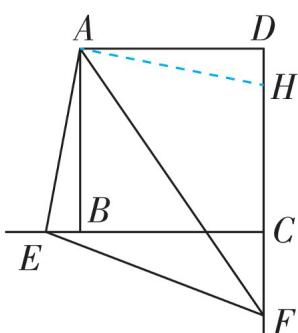
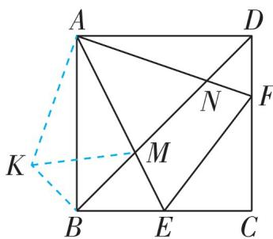

> [!success]- 必刷题
>
> > [!success] **【答案】** ①45, ②BE+DF=EF
>
> > [!note]- **【解析】**
> > 【解】(1)∵四边形ABCD是正方形, ∴∠D=∠DAB=∠ABC=90°. 由旋转得∠ABG=∠D=∠ABE=90°, ∠GAB=∠FAD, AG=AF, BG=DF, ∴G,B,E共线. ∵∠EAF=45°, ∴∠EAG=∠GAB+∠BAE=∠FAD+∠BAE=45°=∠EAF.
> >
> > 在△EAF和△EAG中, $\left\{\begin{aligned}AF&=AG,\\ \angle EAF&=\angle EAG,\\ AE&=AE,\end{aligned}\right.$ ∴△EAF≌△EAG(SAS), ∴EF=EG. ∵BE+BG=EG, ∴BE+DF=EF. 故答案为①45, ②BE+DF=EF.
> >
> > (2) $BE + EF = DF$ . 证明如下: 如图(1), 在 $DC$ 上截取 $DH = BE$ , 连接 $AH$ . 在 $\triangle ABE$ 和 $\triangle ADH$ 中, $\left\{\begin{aligned}AB &= AD,\\ \angle ABE &= \angle D=90^{\circ},\\ BE &= DH,\end{aligned}\right.$
> >
> > 
> > 图(1)
> >
> > 初中必刷题 数学九年级上册 BS
> > ∴ $\triangle ABE \cong \triangle ADH(SAS)$ , ∴ AE = AH, $\angle BAE = \angle DAH$ , ∴ $\angle BAE + \angle BAH = \angle BAH + \angle DAH = 90^{\circ}$ , 即 $\angle EAH = \angle BAD = 90^{\circ}$ . ∵ $\angle EAF = 45^{\circ}$ ,
> > ∴ $\angle EAF = \angle FAH = 45^{\circ}$ . 在 $\triangle EAF$ 和 $\triangle HAF$ 中， $\left\{\begin{aligned}AE&=AH,\\ \angle EAF&=\angle HAF,\\ AF&=AF,\end{aligned}\right.$ (SAS), ∴ EF = HF. ∵ DH + HF = DF, ∴ BE + EF = DF.
> >
> > (3) 如图(2), 将 $\triangle ADN$ 绕点 $A$ 顺时针旋转 $90^{\circ}$ 得到 $\triangle ABK$ , 连接 $KM$ . $\because$ 四边形 $ABCD$ 是正方形, $\therefore AB = AD = 3\sqrt{2}$ , $\angle BAD = 90^{\circ}, \therefore \angle ABD =$
> >
> > 
> > 图(2)
> >
> > 关键点拨
> > 解决本题的关键是根据三角形的任意两边之和大于第三边,得到当 O, A, E 三点共线时,点 A 到点 O 的距离最大.
> >
> > $\angle ADB = 45^{\circ}, BD = \sqrt{AB^{2} + AD^{2}} = 6, \therefore BM = \frac{1}{3} BD = 2, \therefore DM = BD - BM = 4.$ 由旋转可得， $\angle KAN = 90^{\circ}, AK = AN, BK = DN, \angle ABK = \angle ADB = 45^{\circ}, \therefore \angle KBM = \angle ABK + \angle ABD = 90^{\circ}.$ $\because \angle KAN = 90^{\circ}, \angle MAN = 45^{\circ}, \therefore \angle KAM = \angle MAN = 45^{\circ}.$ 又 $\because AM = AM, \therefore \triangle AMK \cong \triangle AMN, \therefore KM = MN.$ 设 $MK = MN = x$ ，则 $BK = DN = 4 - x.$ 在 Rt $\triangle BMK$ 中， $BK^{2} + BM^{2} = MK^{2}$ ， $\therefore (4 - x)^{2} + 2^{2} = x^{2}$ ，解得 $x = 2.5, \therefore MN = 2.5.$
> >
> > ## 思路分析
