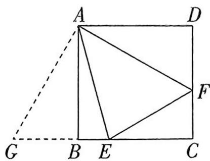
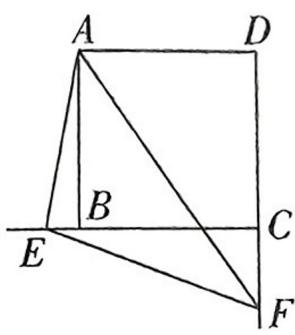
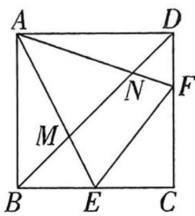
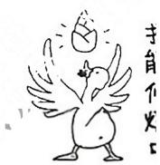

## 大招专题 1 正方形中的三种常考模型

资料更新，关注公众号★全科AA+母题学大招1“十字架”模型

![[初中/课堂同步/教辅/必刷题/2026《初中必刷题》数学北师9上/01_第一章_特殊平行四边形/大招专题_1_正方形中的三种常考模型/questions/Q00107361.md]]

## © 子题练变式

![[初中/课堂同步/教辅/必刷题/2026《初中必刷题》数学北师9上/01_第一章_特殊平行四边形/大招专题_1_正方形中的三种常考模型/questions/Q00107362.md]]
![[初中/课堂同步/教辅/必刷题/2026《初中必刷题》数学北师9上/01_第一章_特殊平行四边形/大招专题_1_正方形中的三种常考模型/questions/Q00107363.md]]

## 母题学大招2 对角互补模型

![[初中/课堂同步/教辅/必刷题/2026《初中必刷题》数学北师9上/01_第一章_特殊平行四边形/大招专题_1_正方形中的三种常考模型/questions/Q00107364.md]]

## 子题练变式

![[初中/课堂同步/教辅/必刷题/2026《初中必刷题》数学北师9上/01_第一章_特殊平行四边形/大招专题_1_正方形中的三种常考模型/questions/Q00107365.md]]

## 母题学大招 3 半角模型

![[初中/课堂同步/教辅/必刷题/2026《初中必刷题》数学北师9上/01_第一章_特殊平行四边形/大招专题_1_正方形中的三种常考模型/questions/Q00107366.md]]

## 【迁移探究】

## 【拓展探索】

(2)如图(2),在正方形ABCD中,若点E在CB的延长线上,点F在DC的延长线上, $\angle EAF=$

$45^{\circ}$ , 猜想线段 $BE, EF, DF$ 之间的数量关系, 并证明.

(3)如图(3),已知正方形ABCD的边长为 $3\sqrt{2}$ , E,F分别在BC,CD上, $\angle EAF=45^{\circ}$ ,连接BD分别交AE,AF于点M,N,若点M恰好为线段BD的三等分点,且BM<DM,求线段MN的长.

图(1)

图(3)

图(2)

电子错题本鸭

建议用时-30分钟 答案 D20
