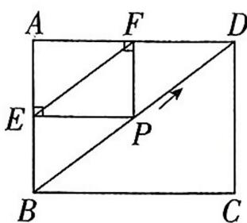

<!-- question-source:start -->
1 [2025 河北衡水质检, 中] 如图, 在矩形 $ABCD$ 中, $AB = 3$ , $AD = 4$ , 且有一点 $P$ 从点 $B$ 出发, 沿着 $BD$ 往点 $D$ 移动, 若过点 $P$ 分别作 $AB$ , $AD$ 的垂线, 垂足分别为 $E$ , $F$ , 则 $EF$ 的最小值为 ( )

A. $\frac{12}{5}$ B. $\frac{18}{5}$ C. 4 D. 5
<!-- question-source:end -->

![[Q00107367A1]]
