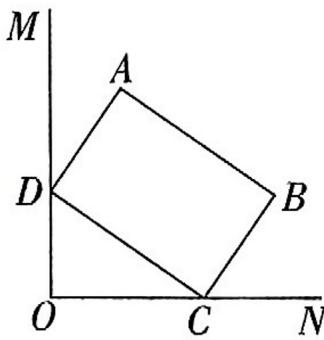

<!-- question-source:start -->
2 [2024 江苏南京鼓楼区质检, 中] 如图, $\angle MON = 90^{\circ}$ , 矩形 $ABCD$ 的顶点 $C, D$ 分别在射线 $ON, OM$ 上滑动, $AB = 9, BC = 6$ , 在滑动过程中, 点 $A$ 到点 $O$ 的最大距离为 \_\_\_\_.

<!-- question-source:end -->

![[Q00107368A1]]
