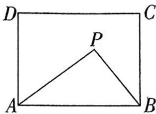

<!-- question-source:start -->
4[2024 河南许昌质检, 中]如图, 在矩形 ABCD 中, AB = 4, AD = 3, 矩形内部有一动点 P, 满足 $S_{\triangle PAB} = \frac{1}{3} S_{矩形ABCD}$ , 则点 P 到 A, B 两点的距离之和 $PA + PB$ 的最小值为 ( )

A. 4 B. $4 \sqrt{2}$ C. $2 \sqrt{2}$ D. 2
<!-- question-source:end -->

![[Q00107370A1]]
