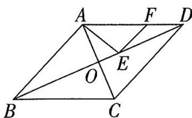

<!-- question-source:start -->
5[2025 河南洛阳质检, 中]如图, 在菱形 $ABCD$ 中, 对角线 $AC, BD$ 相交于点 $O$ , 且 $AC = 10, BD = 24$ , 点 $E, F$ 分别是线段 $OD, AD$ 上的两个动点, 连接 $AE, EF$ , 则 $AE + EF$ 的最小值为 \_\_\_\_.

<!-- question-source:end -->

![[Q00107371A1]]
