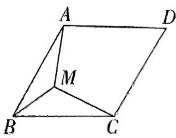

<!-- question-source:start -->
7 [2025 新疆乌鲁木齐校级期中, 较难] 如图, 四边形 $ABCD$ 是菱形, $AB = 6$ , 且 $\angle ABC = 60^{\circ}$ , $M$ 是菱形内

任意一点, 连接 $AM, BM, CM$ , 则 $AM + BM + CM$ 的最小值为 \_\_\_\_.

是个新“烤”鸭

电子错题本鸭
<!-- question-source:end -->

![[Q00107373A1]]
