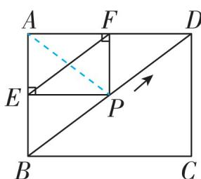

> [!success]- 必刷题
>
> > [!success] **【答案】** A
>
> > [!note]- **【解析】**
> > 如图, 连接 $AP$ . $\because PE \perp AB, PF \perp$
> >
> > $AD, \therefore \angle AEP = \angle AFP = 90^{\circ}$ . $\because$ 四边形 $ABCD$ 是矩形， $\therefore \angle BAD = 90^{\circ}, \therefore$ 四边形 $AEPF$ 为矩形， $\therefore AP = EF,$
> >
> > 
> >
> > ∴ 求 EF 的最小值就是求 AP 的最小值. ∵ 点 P 从点 B 出发, 沿着 BD 往点 D 移动, ∴ 当 $AP \perp BD$ 时, AP 取最小值. 在 Rt $\triangle BAD$ 中, $\angle BAD = 90^{\circ}$ , AB = 3, AD = 4, ∴ BD = $\sqrt{AB^{2} + AD^{2}} = \sqrt{3^{2} + 4^{2}} = \sqrt{25} = 5$ . ∵ 当 $AP \perp BD$ 时, $S_{\triangle ABD} = \frac{1}{2} AB \cdot AD = \frac{1}{2} AP \cdot BD$ , ∴ AP =
> >
> > 成求 $AP$ 的最小值, 再结合垂线段最短, 将问题转化成求 Rt $\triangle BAD$ 斜边上的高, 利用等面积法即可得解.
> >
> > $\frac{AB \cdot AD}{BD} = \frac{3 \times 4}{5} = \frac{12}{5}, \therefore EF$ 的最小值为 $\frac{12}{5}$ . 故选A.
> >
> > 大招解读 | 根据三角形三边关系求最值利用三角形三边关系解决最值问题时, 构造出来的这个三角形要有两条边的长为定值, 另外一边为要求的那条边.
