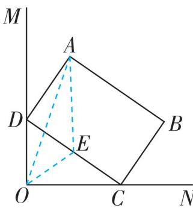

> [!success]- 必刷题
>
> > [!success] **【答案】** 12
>
> > [!note]- **【解析】**
> > 如图, 取 $CD$ 的中点 $E$ , 连接 $OE$ , $AE$ , $OA$ . $\because AB = 9$ , $BC = 6$ , $\therefore CD = 9$ , $AD = 6$ , $\therefore OE = DE = \frac{1}{2}CD = \frac{9}{2}$ , $AE = \sqrt{AD^2 + DE^2} =$
> >
> > $\sqrt{\left(\frac{9}{2}\right)^{2}+6^{2}}=\frac{15}{2}.\because OA\leqslant$ $OE+AE,\therefore$ 当 O,A,E 三点共线时, 点 A 到点 O 的距离最大, $\therefore OA$ 的最大值为 $\frac{9}{2}+\frac{15}{2}=12.$ 故答案为 12.
> >
> > 
