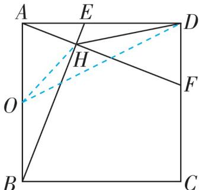
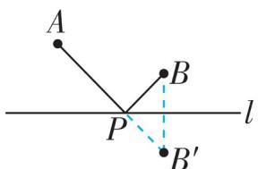

> [!success]- 必刷题
>
> > [!success] **【答案】** $2\sqrt{5} - 2
>
> > [!note]- **【解析】**
> > 如图所示, 取 $A B$ 的中点 $O$ ,
> >
> > 连接 $OH, OD$ . $\because$ 四边形 $ABCD$ 是正方形, $\therefore AB = DA$ , $\angle BAE = \angle ADF = 90^\circ$ . 在 $\triangle BAE$ 和 $\triangle ADF$ 中, $\because \left\{ \begin{array}{l} AE = DF, \\ \angle BAE = \angle ADF, \\ AB = AD, \end{array} \right.$
> >
> > 
> >
> > $\therefore \triangle BAE \cong \triangle ADF(\mathrm{SAS}), \therefore \angle ABE = \angle DAF.$ $\because \angle DAF + \angle BAF = 90^{\circ}, \therefore \angle ABE + \angle BAF = 90^{\circ}, \therefore \angle AHB = 90^{\circ}, \therefore OH = \frac{1}{2} AB = 2.\because OD = \sqrt{OA^{2} + AD^{2}} = \sqrt{2^{2} + 4^{2}} = 2\sqrt{5}, \therefore$ 当 $O, D, H$ 三点在一条直线上时， $DH$ 长度最小，此时 $DH = OD - OH = 2\sqrt{5} - 2.$ 故答案为 $2\sqrt{5} - 2.$
> >
> > \- 大招解读 | “将军饮马”求最值
> >
> > 求直线同侧两点与直线上一动点所连线段和的最小值时,作其中一点关于直线
> >
> > 
> >
> > 的对称点,将两点转化到直线的两侧,利用两点之间线段最短求最小值.
