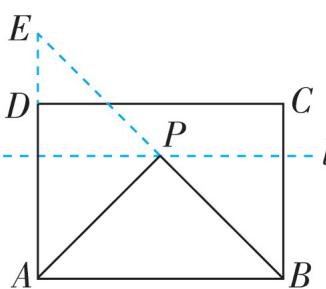

> [!success]- 必刷题
>
> > [!success] **【答案】** B
>
> > [!note]- **【解析】**
> > 设 $\triangle ABP$ 中 $AB$ 边上的高是 $h$ . $\because S_{\triangle PAB} = \frac{1}{3} S_{\text {矩形} ABCD}, \therefore \frac{1}{2} AB \cdot h = \frac{1}{3} AB \cdot AD, \therefore h = \frac{2}{3} AD = 2,$ ∴ 动点 P 在与 AB 平行且与 AB 的距离是 2 的直线 l 上. 如图, 作 A 关于直线 l 的对称点 E, 连接 DE, BE, BE 交直线 l 于点 P, 易得 A, D, E 三点共线, BE 的长就是所求的最小值. 在 Rt△ABE 中, ∵ AB = 4, AE = 2 + 2 = 4, ∴ BE = $\sqrt{AB^2 + AE^2} = \sqrt{4^2 + 4^2} = 4\sqrt{2}$ , 即 $PA + PB$ 的最小值为 $4\sqrt{2}$ . 故选 B.
> >
> > 
