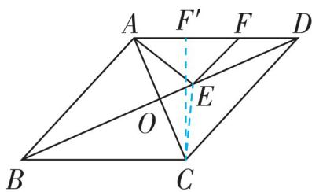
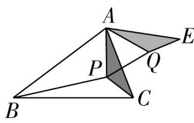
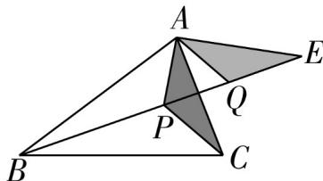

> [!success]- 必刷题
>
> > [!success] **【答案】** $\frac{120}{13}$
>
> > [!note]- **【解析】**
> > 如图, 连接 $CE$ , 过点 $C$ 作 $CF' \perp \overline{AD}$ 于 $F'$ . ∵ 四边形 $ABCD$ 是菱形, ∴ 点 $A$ 与
> >
> > 点 C 关于直线 BD 对称, $\therefore AE = CE, \therefore AE + EF = CE + EF \geqslant CF'$ , $\therefore AE+EF$ 的最小值为
> >
> > 
> >
> > $CF'$ 的长. ∵ 四边形 ABCD 是菱形, AC = 10,
> > BD = 24, ∴ AC ⊥ BD, OA = $\frac{1}{2}$ AC = 5, OD = $\frac{1}{2}BD=12,\therefore$ 由勾股定理, 得 $AD=\sqrt{OA^{2}+OD^{2}}=$ $\sqrt{5^{2}+12^{2}}=13,\therefore S_{菱形ABCD}=\frac{1}{2}AC\cdot BD=AD\cdot$ $CF',\therefore\frac{1}{2}\times10\times24=13CF',$ 解得 $CF'=\frac{120}{13}$ ，即
> > AE+EF 的最小值为 $\frac{120}{13}$ . 故答案为 $\frac{120}{13}$ .
> >
> > 思路分析
> > 连接 CE, 过点 C 作 $CF' \perp AD$ 于 $F'$ . 由菱形性质可得 AE = CE, 即把 $AE + EF$ 的最小值转化为 $CE + EF$ 的最小值, 即为 $CF'$ 的长.
> >
> > ## 大招解读 | “费马定理” 求最值
> >
> > “费马点”是指到三角形三个顶点距离之和最小的点. 主要分为两种情况:
> >
> > (1) 当三角形三个内角都小于 $120^{\circ}$ 时, 通常将其中一个小三角形绕大三角形的一个顶点旋转 $60^{\circ}$ .
> >
> > 例如: 将 $\triangle APC$ 绕 A 点逆时针旋转 $60^{\circ}$ ，得到 $\triangle AQE$ ，连接 PQ，如图（1），则 $\triangle APQ$ 为等边三角形，PA = PQ，
> >
> > 
> >
> > $QE = PC$ ，即 $PA + PB + PC =$ 图(1)
> >
> > $PQ+PB+QE$ , 当 B, P, Q, E 四点共线时取得最小
> >
> > 值,为 BE 的长,如图(2). (2)当三角形有一个内角大于或等于 $120^{\circ}$ 时,费马点就是此内角的顶点.
> >
> > 
> > 图(2)
