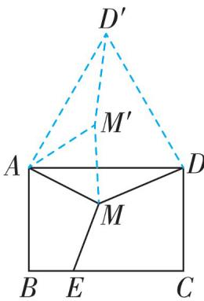
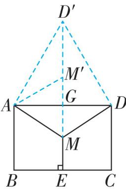

> [!success]- 必刷题
>
> > [!success] **【答案】** $4 + 3\sqrt{3}$
>
> > [!note]- **【解析】**
> > 如图(1)，将 $\triangle AMD$ 绕点 $A$ 逆时针旋转 $60^{\circ}$ 得到 $\triangle AM'D'$ ，连接 $MM'$ ， $DD'$ . 由旋转的性质可知， $MD = M'D'$ ， $AM = AM'$ ， $AD = AD'$ ， $\angle MAM' = \angle DAD' = 60^{\circ}$ ， $\therefore \triangle ADD'$ 和 $\triangle AMM'$ 均为等边三角形， $\therefore AM = MM'$ ， $\therefore MA + MD + ME = D'M' + MM' + ME.$ $\because$ 点 $E$ 为动点， $\therefore$ 当 $D', M', M, E$ 共线，且 $D'E \perp$
> >
> > 将 $\triangle ABM$ 绕点 $B$ 逆时针旋转 $60^{\circ}$ 得到 $\triangle EBN$ ，连接MN，EC，作 $EF\perp BC$ 交CB的延长线于F.由旋转的性质可得 $AM = EN,$ $\triangle BMN$ 是等边三角形，由此将 $AM + BM + CM$ 转化为 $EN + MN + CM$ ，即可得出当 $E,N,M,C$ 共线时， $AM+$ $BM + CM$ 的值最小，根据勾股定理求解即可.
> >
> > BC 时, $MA+MD+ME$ 的值最小,如图(2),设 $D'E$ 交 AD 于 G,此时易求得 $D'E=D'G+GE=4+3\sqrt{3}$ ,∴ $MA+MD+ME$ 的最小值为 $4+3\sqrt{3}$ .
> >
> > 
> > 图(1)
> >
> > 
> > 图(2)
