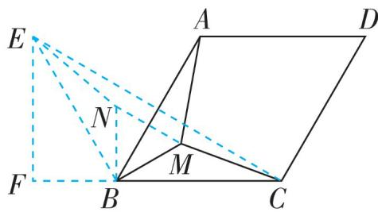

> [!success]- 必刷题
>
> > [!success] **【答案】** $6\sqrt{3}$
>
> > [!note]- **【解析】**
> > 如图, 将 $\triangle A B M$ 绕点 $B$ 逆时针旋转 $60^{\circ}$ 得到 $\triangle E B N$ , 连接 $M N, E C$ , 作 $E F \perp$
> >
> > CB 交 CB 的延长线于点 F. 由旋转得 AB = BE, MB = NB, AM = EN, $\angle MBN = \angle ABE =$
> >
> > 
> >
> > $60^{\circ}, \therefore \triangle BMN$ 是等边三角形, $\therefore BM = MN$ , $\therefore AM + BM + CM = EN + MN + CM$ , $\therefore$ 当 $E, N, M, C$ 共线时, $EN + MN + CM$ 的值最小, 即 $EN + MN + CM$ 的最小值为 $CE$ 的长. $\because \angle ABE = \angle ABC = 60^{\circ}, \therefore \angle EBF = 60^{\circ}$ . $\because BC = AB = BE = 6$ , $\therefore$ 易得 $BF = 3, EF = 3\sqrt{3}$ . 在 Rt $\triangle EFC$ 中, $\because EF^{2} + FC^{2} = EC^{2}, \therefore EC = \sqrt{EF^{2} + FC^{2}} = 6\sqrt{3}$ , 即 $AM + BM + CM$ 的最小值为 $6\sqrt{3}$ . 故答案为 $6\sqrt{3}$ .
> >
> > ## 全章综合训练
